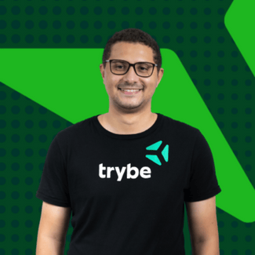
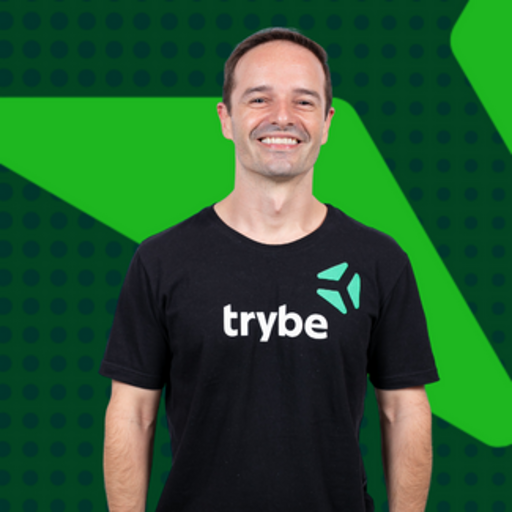

# 1.2 - Com quem você aprenderá?

> Seção 1 - Boas-vindas · Lição 2 de 2

Conheça os profissionais que irão guiar sua jornada no curso de Node.js.

Neste curso, você terá a oportunidade de aprender com uma equipe de especialistas com sólida experiência em desenvolvimento de software. Cada professor traz um profundo conhecimento técnico e prática do mercado para ajudá-lo a evoluir nessa jornada de aprendizado.

<table><tbody><tr><td width="20%"><figure></figure></td><td>
<b>Gabriel Dalseco (Coruja)</b>

Engenheiro mecânico com pós-graduação em Arquitetura de Software, possui mais de 4 anos de experiência no setor de educação, integrando tecnologia e aprendizado. Leciona disciplinas como Node.js (JavaScript e TypeScript) e outras tecnologias back-end, como Java. Atualmente, está empenhado em explorar novas formas de ensino, combinando didática prática e inovação, com foco em tornar a jornada de aprendizado em programação mais acessível e motivadora.
</td></tr><tr><td width="20%"><figure></figure></td><td>
<b>Henrique Baeta</b>

Programador e Educador com mais de 10 anos de experiência. Formado pela Trybe em Desenvolvimento de Software FullStack, com domínio em JavaScript e Python.
</td></tr></tbody></table>

Com a orientação dessa equipe, o curso oferece uma abordagem clara e prática das tecnologias mais utilizadas no desenvolvimento de software. Você aprenderá a arquitetar e construir suas próprias APIs Web utilizando Node.js de forma eficiente.
