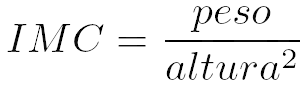

# 2.10 - Exercícios - agora, a prática

> Seção 2 - Introdução ao Node.js · Lição 10 de 11

## Exercício 1

Crie um código para calcular o índice de massa corporal(IMC) de uma pessoa.

> OBS: a sigla IMC, traduzida para o inglês, equivale a BMI(Body Mass Index). Vamos adotar este padrão nos códigos para começarmos a nos acostumar com o formato que aparecerá no mercado de trabalho!

-   A fórmula para calcular o IMC é:
    -   **Obs:** Lembre-se que a altura é em metros, caso deseje usar em centímetros a conversão para metros será necessária.
-   Comece criando um novo pacote Node com `npm init` e respondendo às perguntas do `npm`.
    -   Escolha um nome para o seu pacote e adicione o seu nome na opção `author`.
-   Armazene o código no arquivo `bmi.js`.
-   Adicione duas constantes com valores fixos para `weight` e `height`.
-   Agora, crie o restante da lógica para fazer o cálculo do IMC. Pode criar o cálculo dentro ou fora do escopo de funções.

**Solução**

-   Criar uma nova pasta para conter os scripts do dia. Escolha o nome que preferir.
-   Dentro da nova pasta, criar um novo pacote Node.js com o seguinte comando:

```
npm init
```

-   Quando aparecer o campo para digitar `package name`, digite `my-scripts`.
-   Pressione `enter` até a pergunta `author` e digite seu nome neste campo.
-   Pressione `enter` para todas as demais perguntas.
-   Crie o arquivo `bmi.js` e implemente uma lógica:

```
const weightInKg = 80; // Você pode utilizar o valor que desejar aqui
const heightInCm = 178; // Você pode utilizar o valor que desejar aqui
function handleBMI(weight, height) {
  console.log(`Weight: ${weight}, Height: ${height}`);
  const heightInMeters = height / 100; // conversão para metros
  const heightSquared = heightInMeters ** 2;
  const bmi = weight / heightSquared;
  return bmi;
}
// A função main é o ponto de partida do nosso programa
function main() {
  const bmi = handleBMI(weightInKg, heightInCm);
  console.log(`BMI: ${bmi.toFixed(2)}`);
}
main();
```

-   Execute o script utilizando `node bmi.js` e certifique-se de que os valores retornados estão corretos. Você pode utilizar [esta calculadora](https://www.programasaudefacil.com.br/calculadora-de-imc) para validar o resultado.

## Exercício 2

Agora, permita que o código seja executado através do comando `npm run bmi`.

-   O novo código criado deve conter o comando que chama o `node` para executar o arquivo `bmi.js`.

**Solução**

-   Edite o arquivo `package.json` para adicionar o novo script com a chave `bmi` e valor `node bmi.js`:

```
{
  // ...
  "scripts": {
    // ...
    "bmi": "node bmi.js"
  }
  // ...
}
```

-   Execute o script através do comando `npm run bmi` e confira se o código é executado.

## Exercício 3

Chegou a hora de tornar nosso código mais interativo! Vamos adicionar inputs de entrada para quem usar.

-   Edite o código para que os valores de `weight` e `height` sejam informados pela pessoa ao responder as perguntas: "What's your weight?" e "What's your height?", deve-se utilizar o pacote `readline-sync`.

**Solução**

-   Instale o pacote `readline-sync`:

```
npm i --save-exact readline-sync@1.4.10
```

-   Importe o `readline-sync` no arquivo `bmi.js` e substitua os valores das variáveis `weight` e `height` por perguntas à pessoa que executou o script. Utilizaremos o método `questionInt` do pacote `readline-sync`:

```
const readline = require('readline-sync');
// function handleBMI(weight, height) {
//   console.log(`Weight: ${weight}, Height: ${height}`);
//   const heightInMeters = height / 100;
//   const heightSquared = heightInMeters ** 2;
//   const bmi = (weight / heightSquared);
//   return bmi;
// }
// function main() {
   const weight = readline.questionInt('What\'s your weight? (kg) ');
   const height = readline.questionInt('What\'s your height? (cm) ');
   const bmi = handleBMI(weight, height);
//   console.log(`BMI: ${bmi.toFixed(2)}`);
// }
// main();
```

-   Após a implementação do código, execute o comando `npm run bmi` e insira os valores de peso e altura. É esperado que a aplicação retorne o IMC.

## Exercício 4

Agora temos um problema, o `peso` não é um número inteiro! Isso quer dizer que precisamos mudar um pouco a forma como solicitamos o input deste dado.

-   O pacote `readline-sync` possui uma função específica para tratar esses casos. Consulte a [documentação](https://www.npmjs.com/package/readline-sync#utility-methods) do pacote e encontre a função adequada para realizar input de valores **float**.
-   Encontrou a função? Show! Agora utilize-a para solicitar o input de `weight`.
-   Lembre-se de passar o valor de `weight` utilizando o formato com ponto, ao invés de vírgula para casas decimais. Ex: `78.5`;

**Solução**

-   Encontre, na documentação do `readline-sync`, a função `questionFloat`;
-   Altere o código da função `main` para que em vez de `questionInt`, passe a utilizar a função `questionFloat` ao solicitar o peso da pessoa:

```
// const readline = require('readline-sync');
// function handleBMI(weight, height) {
//   console.log(`Weight: ${weight}, Height: ${height}`);
//   const heightInMeters = height / 100;
//   const heightSquared = heightInMeters ** 2;
//   const bmi = (weight / heightSquared);
//   return bmi;
// }
// function main() {
  const weight = readline.questionFloat('What\'s your weight? (kg) ');
//   const height = readline.questionInt('What\'s your height? (cm) ');
//   const bmi = handleBMI(weight, height);
//   console.log(`BMI: ${imc.toFixed(2)}`);
// }
// main();
```

-   Após a implementação do código, execute o comando `npm run bmi` e insira os mesmos valores anteriores, só que agora adicione números decimais para o peso. É esperado que a aplicação retorne um IMC diferente do exercício anterior.

## Exercício 5

Vamos sofisticar um pouco mais nosso exercício. Além de imprimir o IMC na tela, imprima também em qual categoria da tabela abaixo aquele IMC se enquadra:

-   Considere a seguinte tabela para classificar a situação do IMC:IMC  
    Situação  
      
      
    Abaixo de 18,5  
    Abaixo do peso (magreza)  
      
    Entre 18,5 e 24,9  
    Peso normal  
      
    Entre 25,0 e 29,9  
    Acima do peso (sobrepeso)  
      
    Entre 30,0 e 34,9  
    Obesidade grau I  
      
    Entre 35,0 e 39,9  
    Obesidade grau II  
      
    40,0 e acima  
    Obesidade graus III e IV

**Solução**

-   Aqui nós temos a opção de fazer uma série de verificações com `if`, para saber em que situação se encontra o IMC calculado. Porém, a utilização de muitos `if`s pode aumentar bastante a complexidade ciclomática do código. Sendo assim, resolveremos de outra maneira. Mas, a título de exemplo, a solução com `if` seria a inclusão de um código como esse:

```
// ...
// Considerando que nesse trecho temos o valor do IMC na variável "imc"
    if (bmi < 18.5) {
      console.log('Status: Underweight (thin)');
      return;
    }
    if (bmi >= 18.5 && bmi < 25) {
      console.log('Status: Normal weight');
      return;
    }
    if (bmi >= 25 && bmi < 30) {
      console.log('Status: Overweight');
      return;
    }
    if (bmi >= 30 && bmi < 35) {
      console.log('Status: Grade I obesity');
      return;
    }
    if (bmi >= 35 && bmi < 40) {
      console.log('Status: Grade II obesity');
      return;
    }
    console.log('Status: Obesity grades III and IV');
// ...
```

-   Para evitarmos essa quantidade de verificações, podemos primeiramente mapear, em um objeto, os IMCs máximos e mínimos de cada situação.

```
// ...
// function handleBMI(weight, height) {
//   ...
// }
const BMI_MAX_AND_MIN = {
  'Underweight': {
    minBMI: 0,
    maxBMI: 18.4,
  },
  'Normal Weight': {
    minBMI: 18.5,
    maxBMI: 24.9,
  },
  'Overweight': {
    minBMI: 25,
    maxBMI: 29.9,
  },
  'Obese Class I': {
    minBMI: 30.0,
    maxBMI: 34.9,
  },
  'Obese Class II': {
    minBMI: 35,
    maxBMI: 39.9,
  },
  'Obese Class III': {
    minBMI: 40,
    maxBMI: 100, // Um valor default máximo qualquer, impossível de alcançar no imc.
  },
};
// function main() {
//   ...
// }
```

-   Agora que temos as relações entre as situações e os IMCs máximos/mínimos mapeadas, podemos verificar para cada chave (situação) do objeto `BMI_MAX_AND_MIN`, onde o IMC calculado se encontra. Para isto, vamos criar uma função chamada `handleBMIResult`, na qual primeiramente extrairemos as chaves do objeto `BMI_MAX_AND_MIN`. Em seguida, iremos iterar no array em que as as chaves são listadas e utilizar o `find` para encontrar a situação cujo intervalo compreenda o IMC Calculado.

```
// const BMI_MAX_AND_MIN = {
// ...
// }
function handleBMIResult(bmi) {
  const statuses = Object.keys(BMI_MAX_AND_MIN); // ['Underweight', 'Normal Weight', 'Overweight'...]
  const resultFind = statuses.find((status) => {
    const { maxBMI, minBMI } = BMI_MAX_AND_MIN[status]; // acessamos as informações do intervalo da situação iterada
    // caso esteja dentro do intervalo, significa que encontramos a situação apropriada
    return bmi >= minBMI && bmi <= maxBMI;
  });
  return resultFind;
}
// function main() {
// ...
// }
```

-   Para finalizar, executaremos a `handleBMIResult` e mostraremos o seu resultado na função `main`, no console.

```
// ...
// function main() {
//   const weight = readline.questionFloat('What\'s your weight? (kg) ');
//   const height = readline.questionInt('What\'s your height? (cm) ');
//   const bmi = handleBMI(weight, height);
   const bmiResult = handleBMIResult(bmi);
//   console.log(`BMI: ${bmi.toFixed(2)}`);
  console.log(bmiResult);
// }
// main();
```
