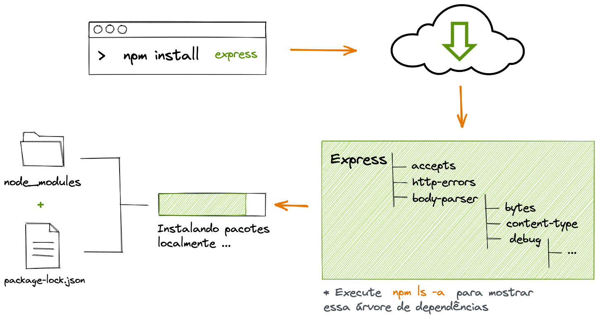

# 3.2 - Express

> Seção 3 - API REST com Express · Lição 2 de 20

## Como vamos construir uma API no Node.js?

Para criar uma API no Node.js, precisamos de uma forma eficiente de receber, processar e responder a requisições. E é aí que o [Express](https://expressjs.com/) entra em cena.

### O que é o Express?

O `Express` é um *framework* minimalista e flexível para Node.js, que nos fornece as ferramentas necessárias para construir APIs robustas e organizadas com poucas linhas de código. Ele é amplamente utilizado devido à sua simplicidade e eficiência, permitindo que desenvolvedores se concentrem na lógica da aplicação, sem se preocupar com detalhes complexos de infraestrutura.

### O que é um framework?

Um *framework* é como um conjunto de ferramentas pré-construídas que ajudam a estruturar e organizar sua aplicação. Pense nele como um "molde" que guia o desenvolvimento de uma aplicação, fornecendo padrões e funcionalidades prontas para uso.

Imagine que você precisa fazer uma sopa em grande escala, como em um restaurante. Em vez de fazer tudo do zero cada vez, você segue um processo organizado, com ferramentas e etapas pré-definidas para garantir eficiência e consistência. O Express faz algo semelhante no desenvolvimento de APIs: ele sugere uma forma eficaz de construir sua aplicação, oferecendo as ferramentas necessárias para isso.

### Instalando o Express

Vamos colocar a mão na massa e instalar o Express na sua aplicação. Para isso, execute os seguintes comandos no seu terminal:

1.  Para criar os diretórios no qual iremos trabalhar e abrir o `VS Code`:

```bash
mkdir soccer-team-manager soccer-team-manager/src && cd soccer-team-manager && code .
```

1.  Para iniciar um pacote Node.js:

```bash
npm init -y
```

1.  Para instalar o Express no nosso projeto:

```bash
npm i express@4.17.1 --save-exact
```

> **Atenção ⚠️:** Usaremos a versão `4.17.1` para garantir que todos os exemplos e práticas deste bloco funcionem corretamente. Fixar a versão evita que tenhamos comportamentos inesperados na nossa aplicação.

Após a instalação, dois itens importantes serão criados automaticamente:

-   `package-lock.json`: Gerencia as versões exatas das dependências, garantindo que todos no projeto utilizem as mesmas versões.
-   `node_modules`: Diretório onde todas as dependências (e as dependências das dependências) serão instaladas.

 Ilustração sobre funcionamento de uma instalação de dependências através do npm.

<details>
<summary>OBS da IA</summary>

**Alternativa mais moderna**

-   O curso fixa **Express 4.17.1**. A versão estável atual é o **Express 5** (`npm i express` já instala a 5.x). Principais mudanças: erros de handlers `async` vão sozinhos para o middleware de erro, sintaxe de rotas mais rígida (`*` precisa de nome, `?` opcional mudou para `{/:id}`), `req.body` fica `undefined` sem parser e `req.query` passa a ser somente leitura.
-   O código básico do curso (`express()`, `app.get`, `app.listen`, `express.Router`) funciona igual no Express 5.

</details>

### Como as dependências funcionam?

Pense no Express como um pacote que sua aplicação precisa para funcionar. Esse pacote, por sua vez, depende de outros pacotes, que dependem de outros pacotes, e assim por diante. O Node.js cuida de instalar e gerenciar todas essas dependências de forma automática e inteligente, evitando duplicações e garantindo que tudo funcione perfeitamente.

O resultado? Uma instalação eficiente e organizada, que facilita o desenvolvimento e a manutenção da sua aplicação.

### Utilizando Git e \`.gitignore\`\`

Agora que instalamos o Express e o diretório `node_modules` foi criado, é importante seguir boas práticas ao usar o Git para versionar seu projeto. Uma dessas práticas é não versionar a pasta `node_modules` (enviar para o GitHub), pois ela contém todas as dependências instaladas e pode ficar muito grande, ocupando espaço desnecessário no repositório.

Para evitar isso, adicione um arquivo `.gitignore` na raiz do seu projeto e inclua a pasta `node_modules` nele:

```bash
# .gitignore
node_modules/
```

Isso garante que a pasta `node_modules` não seja enviada ao repositório. Quem clonar seu projeto poderá baixar todas as dependências facilmente, executando o comando `npm install`, que lerá o arquivo `package.json` e instalará todas as dependências necessárias.

Essa prática mantém seu repositório mais limpo e evita problemas com arquivos desnecessários ocupando espaço.

### Criando o Servidor

Configurar seu projeto é um passo crucial! Quando você começa a trabalhar em um projeto, precisa entender como ele está configurado para poder continuar o desenvolvimento. Em um teste técnico, por exemplo, é comum ter que configurar uma aplicação do zero. Portanto, saber lidar com as configurações iniciais de um projeto é fundamental.

Agora que concluímos as configurações iniciais, vamos criar nosso servidor Node.js com Express.

Primeiro, no diretório `src`, crie dois arquivos: `app.js` e `server.js`. Para o tamanho atual da nossa aplicação, isso é suficiente. Se precisarmos de mais arquivos, refatoramos depois. 🔧

Vamos começar pelo `app.js`:

```javascript
// src/app.js
const express = require('express');
const app = express();
module.exports = app;
```

Aqui, importamos o Express e inicializamos a aplicação com `express()`, armazenando na variável `app`, que é exportada para ser usada em `server.js`. A variável `app` contém todas as funcionalidades do Express que utilizaremos em breve.

Agora, crie o **servidor** em `server.js`:

```javascript
// src/server.js
const app = require('./app');
app.listen(3001, () => console.log('Server running on port 3001'));
```

Neste arquivo, apenas importamos o `app` e iniciamos o servidor com `app.listen`. O `listen` recebe dois parâmetros:

-   Primeiro parâmetro é o `port`: Significa a `porta` que a sua aplicação ocupará quando estiver ativa, neste caso, será a porta 3001.
-   Segundo parâmetro é uma `função`: Neste exemplo, exibe apenas uma mensagem no console informando que o servidor está rodando.

Vamos a pergunta, por que separamos em dois arquivos? Isso mantém o código mais organizado e facilita o crescimento da aplicação. Além disso, será útil quando começarmos a aprender testes de unidade e integração.

Para finalizar o servidor, adicione estes scripts ao `package.json`:

```json
// package.json
"start": "node src/server.js",
"dev": "nodemon src/server.js",
```

Agora, execute a sua aplicação com o seguinte comando:

```bash
npm start
```

Você verá a mensagem `Server running on port 3001` no console, indicando que o servidor está funcionando corretamente. Para parar a aplicação, digite em seu terminal `Ctrl + c`.

> **Anota aí 🖊:** Em termos simples, o sistema operacional do seu computador gerencia como todos os programas interagem entre si e com a rede. Cada programa que se comunica pela internet ou por uma rede local precisa escolher uma "porta", que é um número específico usado para identificar essa comunicação. O sistema operacional garante que todas as informações enviadas para o computador, direcionadas a uma porta específica, sejam entregues ao programa que está "ouvindo" nessa porta. Quando dizemos que um programa está "ouvindo" uma porta (em inglês, "listen"), significa que ele está preparado para receber todas as mensagens que chegam através daquele número de porta. Em resumo, ao escolher uma porta, o programa garante que todo o tráfego destinado a essa porta será direcionado a ele. Vamos explorar como isso funciona mais adiante.

Agora, sobre os scripts do `package.json`: O script dev não funcionará ainda porque usamos o comando nodemon, que não está instalado. Vamos resolver isso agora.

### Ganhando Produtividade com Nodemon

Após executar o servidor com npm start, qualquer alteração no código requer parar e reiniciar o servidor para que as mudanças tenham efeito. Isso pode ser cansativo e propenso a erros.

Para evitar isso, utilizamos o `Nodemon`, que reinicia automaticamente o servidor sempre que você salva um arquivo.

Já configuramos o script `dev` para usar o Nodemon. Agora, vamos instalá-lo:

```bash
npm i nodemon@2.0.15 --save-dev --save-exact
```

Após a instalação, execute:

```bash
npm run dev
```

Agora, sempre que salvar um arquivo, o Nodemon reiniciará automaticamente o servidor, tornando o desenvolvimento mais ágil e eficiente.

Você acabou de aprender a usar o Nodemon para facilitar o desenvolvimento de APIs Node.js com Express. Prepare-se, porque as coisas vão ficar ainda mais interessantes! 🤩

<details>
<summary>OBS da IA</summary>

**Alternativa mais moderna**

-   O Node tem watch mode nativo (estável no Node 22+): `"dev": "node --watch src/server.js"` — dispensa o `nodemon`. Combina com `--env-file`: `node --watch --env-file=.env src/server.js`.

**Para o SAP CAP**

-   No CAP você **não cria o servidor Express na mão**: o `@sap/cds` sobe um Express internamente e expõe os serviços definidos em CDS. `cds watch` faz o papel do `nodemon`.
-   Se precisar de middlewares próprios, crie um `server.js` na raiz e use `cds.on('bootstrap', (app) => app.use(...))`.

</details>
