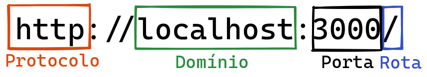

# 3.3 - Nossa primeira API: Hello, World!

> Seção 3 - API REST com Express · Lição 3 de 20

Chegou o grande momento! Vamos criar nossa primeira rota no arquivo `app.js`, que fica no diretório `src/`:

```javascript
// src/app.js
// const express = require('express');
// const app = express();
app.get('/', (req, res) => res.status(200).json({ message: 'Hello, World!' }));
// module.exports = app;
```

Não se esqueça de executar o comando `npm run dev` para iniciar o servidor da sua aplicação.

Agora, abra o navegador e acesse o link http://localhost:3001/ e verá que já alcançamos mais um marco: "*Utilizar* o *Node.js* com o *framework Express* para criar uma *rota* de um *endpoint* de API, acessível pelo browser".

## Entendendo nosso código

Analisando novamente a última linha que adicionamos ao código:

```javascript
app.get('/', (req, res) => res.status(200).json({ message: 'Hello, World!' }));
```

Dentro da constante `app`, temos diversos recursos disponíveis, sendo um deles a função `get`, que usamos toda vez que queremos **pedir** algum dado.

Observe que a função `get` recebe dois parâmetros:

-   1° parâmetro `'/'`: Este é o caminho da URL que desejamos configurar. Pode ser `/login`, `/produtos`, `/pessoas`, ou qualquer outro. Neste exemplo, estamos usando apenas `/`, que é a rota **raiz**.  
    
-   2° parâmetro `(req, res) => {}`: Esta função é chamada quando a rota é acessada. Ela pode receber de 2 a 4 parâmetros, sendo os mais comuns:  
    -   `req` (Request): Representa a requisição feita pelo cliente, permitindo o acesso aos dados enviados, como *query, params e body* (veremos mais sobre isso);
    -   `res` (Response): Representa a resposta que enviaremos dada uma solicitação;

Agora, observe o trecho `res.status(200).json({ message: 'Hello, World!' })` e vamos analisar cada parte:

-   `res` como comentado, responde as requisições. Existem diferentes formas de responder a requisições, tais como:
    -   Formato text/JSON, como o caso do `res.json({ message: 'Hello, World!' })`;
    -   Formato text/HTML, como o caso do `res.send('<h1>Hello, World!</h1>')`;
    -   Redirecionamentos, como o caso do `res.redirect('https://www.betrybe.com/')`;
    -   Páginas completas ou partes dela, como o caso do `res.render('index.html')`;
    -   Finalizando, como o caso do `res.end()`;

> ⚠️ Atenção: Por enquanto, vamos nos concentrar apenas no formato JSON.

## Status Code

Normalmente, enviamos um *status code* junto com a resposta, como em `res.status(200)...`. Esses *status code* são essenciais para identificar o que está acontecendo com as requisições. Não se preocupe em decorá-los agora; com o tempo, você se acostumará a usá-los. E se surgir alguma dúvida, [a documentação do MDN](https://developer.mozilla.org/pt-BR/docs/Web/HTTP/Status) é um ótimo recurso para consulta.

Os *status code* mais conhecidos são:

-   `200`: Significa 'OK' (Tudo certo);
-   `500`: Indica um erro no Servidor;
-   `404`: Este muitas pessoas já viram, indica que a página não foi encontrada;

> **De olho na dica👀:** Para facilitar a leitura do código, associe os *status code* a constantes nomeadas! `const OK = 200`, `const INTERNAL_SERVER_ERROR = 500` e `const NOT_FOUND = 404`.

## URLs

Vamos entender neste momento a anatomia da URL da resultante da nossa API:

 Informações adicionais do framework Express

Como estamos executando a aplicação localmente, usamos o domínio `localhost`. Note que na figura, a porta é especificada, como em `http://localhost:3000/`, mas em nossa aplicação estamos utilizando a porta `3001`!

> Quando estamos trabalhando localmente, temos a flexibilidade de escolher as portas e rodar várias aplicações em paralelo. Já no site da Trybe, por exemplo, a porta não é mencionada, pois geralmente é a porta padrão (servidores HTTP geralmente respondem na porta 80).

Agora, vamos assistir a um vídeo que traz mais exemplos e contexto sobre o que abordamos até agora nesta seção!

> **Vídeo da aula:** [assistir online](https://player.vimeo.com/video/1022265242)

<details>
<summary>OBS da IA</summary>

**Para o SAP CAP**

-   O "Hello World" no CAP é uma **function** declarada em CDS e implementada em JS. O endpoint fica em `GET /odata/v4/hello/hello(to='Mundo')`.

```cds
// srv/hello-service.cds
service HelloService {
  function hello(to : String) returns String;
}
```

```javascript
// srv/hello-service.js
const cds = require('@sap/cds');

module.exports = class HelloService extends cds.ApplicationService {
  init() {
    this.on('hello', (req) => `Hello, ${req.data.to}!`);
    return super.init();
  }
};
```

</details>
