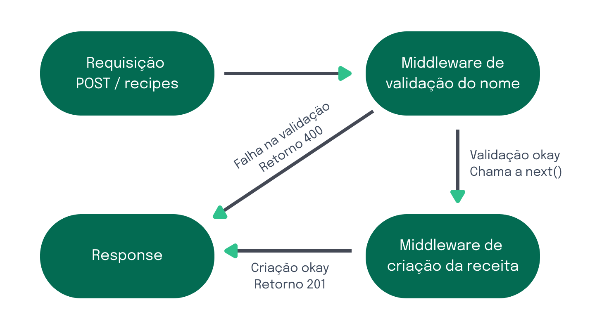

# 3.12 - Middlewares no Express

> Seção 3 - API REST com Express · Lição 12 de 20

No Express, middlewares são funções que interceptam e processam requisições HTTP antes que cheguem ao endpoint final. Eles podem ser utilizados para validar dados, realizar autenticação, gerenciar permissões ou manipular a resposta da requisição.

Na prática, um middleware recebe três parâmetros: `req`, `res` e `next`. A função `next()` é chamada para indicar que o middleware terminou sua tarefa e que a próxima função na pilha de middlewares ou o endpoint final pode ser executado.

## Como funcionam os Middlewares?

Quando fazemos uma requisição, ela passa por uma cadeia de middlewares antes de chegar ao seu destino final (o endpoint). Cada middleware pode:

-   Alterar o objeto da requisição (`req`) ou da resposta (`res`);
-   Encerrar o ciclo da requisição, enviando uma resposta;
-   Chamar o próximo middleware da cadeia com `next()`.

Se nenhum middleware retornar uma resposta ou chamar o `next()`, a requisição ficará "travada" e quem fez a requisição não receberá uma resposta.

## Exemplo Prático: Middleware para Validação de Dados

Agora, voltando à nossa API de times, vamos criar um middleware simples chamado validateTeam, que será utilizado nas requisições POST e PUT para garantir que os dados enviados contenham os campos name e initials devidamente preenchidos.

> **Atenção ⚠️:** Fique atento ao comentário no início dos exemplos, pois ele indicará em qual arquivo o código deve ser colocado. Seguiremos esse formato para orientar onde adicionar cada trecho de código. Neste exemplo, o código deve ser inserido em `src/middlewares/validateTeam.js`.

```javascript
// src/middlewares/validateTeam.js
function validateTeam(req, res, next) {
  const { name, initials } = req.body;
  // name deve existir e ser do tipo string
  if (!name || typeof name !== 'string') {
    return res.status(400).json({ message: 'Invalid or missing "name" field' });
  }
  // initials deve existir
  if (!initials) {
    return res.status(400).json({ message: 'Missing "initials" field' });
  }
  // initials deve ter pelo menos 3 caracteres
  if (initials.length !== 3) {
    return res.status(400).json({ message: 'Initials must be exactly 3 characters long' });
  }
  // Tudo certo, passa para o próximo middleware ou rota
  next();
}
module.exports = validateTeam;
```

Neste exemplo, o middleware verifica se os campos `name` e `initials` estão presentes e corretos. Se houver algum erro, ele retorna uma resposta com status 400 (Bad Request) e uma mensagem de erro. Caso contrário, ele chama `next()` para seguir adiante.

## Utilizando o Middleware nas Rotas PUT e POST

Agora, vamos aplicar o `validateTeam` nas rotas de POST e PUT, que são usadas para criar e atualizar times.

```javascript
// src/app.js
// const express = require('express');
// const fs = require('fs').promises;
// const path = require('path');
const validateTeam = require('./middlewares/validateTeam');
// const app = express();
// app.use(express.json());
// Outras rotas
// Rota POST para criar um novo time
app.post('/teams', validateTeam, async (req, res) => {
  // const { name, initials } = req.body;
  // Lógica para criar o time
});
// Rota PUT para atualizar um time existente
app.put('/teams/:id', validateTeam, async (req, res) => {
  // const { id } = req.params;
  // const { name, initials } = req.body;
  // Lógica para atualizar o time
});
// module.exports = app;
```

## Entendendo o Fluxo do Middleware validateTeam

1.  O middleware faz uma validação básica, verificando se os campos esperados estão presentes e corretos no `req.body`.  
    
2.  Se a validação for bem-sucedida, o middleware chama o `next()`, permitindo que a requisição chegue ao próximo middleware ou à rota que processa a criação ou atualização do time.  
    
3.  Se a validação falhar, o middleware retorna uma resposta com status `400` (Bad Request), e o fluxo da requisição é interrompido. O status 400 indica que houve um erro com a solicitação feita, geralmente devido a dados inválidos ou ausentes. Esse é o comportamento esperado para informar que algo está incorreto com a requisição. Para mais detalhes sobre códigos de status HTTP como o 400, consulte a [documentação](https://developer.mozilla.org/en-US/docs/Web/HTTP/Status/400) no site da MDN (Mozilla Developer Network).  
    

Abaixo, veja um diagrama ilustrando o fluxo da requisição através dos middlewares:

 Passo a passo da requisição passando pelos middlewares

Assita ao vídeo abaixo, para rever sobre os conceitos de middleware e explorar novas possibilidades:

> **Vídeo da aula:** [assistir online](https://player.vimeo.com/video/1022283830)

<details>
<summary>OBS da IA</summary>

**Alternativa mais moderna**

-   Validações manuais campo a campo costumam ser trocadas por schemas declarativos (Joi, visto na seção 6, ou **Zod**, hoje muito popular).

**Para o SAP CAP**

-   No CAP boa parte dessas validações é **declarativa no CDS**: `@mandatory`, `@assert.range`, `@assert.format`, `@assert.target`, `@readonly`. O restante vai em handlers `before` usando `req.error()` / `req.reject()`.

```cds
entity Teams {
  key ID   : Integer;
  name     : String(100) @mandatory;
  initials : String(3)   @mandatory @assert.format: '^[A-Z]{3}$';
}
```

</details>
