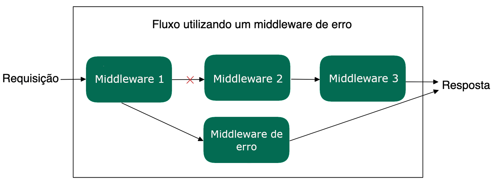

# 3.14 - Middlewares de Erro

> Seção 3 - API REST com Express · Lição 14 de 20

Até o momento, discutimos os middlewares comuns, que recebem os parâmetros `req`, `res` e `next`, e são responsáveis por tratar as requisições quando tudo corre bem. No entanto, ao desenvolver uma aplicação, é crucial lidar com possíveis falhas que possam ocorrer durante o processamento de uma requisição. Para isso, o Express oferece um outro tipo de middleware: o middleware de erro.

## O que é um Middleware de Erro?

Um middleware de erro tem uma função específica dentro do ciclo de vida de uma requisição. Ele é projetado para interceptar e lidar com erros que podem ser gerados por outros middlewares ou rotas. Diferente dos middlewares comuns, que tratam requisições bem-sucedidas, o middleware de erro é executado apenas quando algum erro é lançado ou quando a função `next()` é chamada com um parâmetro de erro.

### Como funciona um Middleware de Erro?

Aqui estão alguns pontos importantes sobre middlewares de erro:

-   **Ordem Importa:** Middlewares de erro devem ser sempre declarados após todas as rotas e middlewares comuns da aplicação. Isso garante que eles sejam acionados somente quando um erro ocorrer em qualquer ponto anterior do fluxo de requisição.  
    
-   **Quatro Parâmetros:** Diferente dos middlewares normais, o middleware de erro sempre recebe quatro parâmetros: `(err, req, res, next)`. O primeiro parâmetro, `err`, é o erro que foi gerado ou passado adiante por um middleware anterior, sinalizando que algo deu errado.  
    
-   **Chamando o `next()` com Erros:** Quando um middleware ou rota chama `next()` com um argumento, isso indica que ocorreu um erro. Esse argumento será passado automaticamente para o middleware de erro.  
    

### Exemplo de Middleware de Erro

Vamos ver um exemplo prático de como implementar um middleware de erro no Express. Neste caso, usaremos a rota GET `/teams`, nela utilizaremos o módulo `fs` para ler um arquivo JSON (`teams.json`) e retornar seu conteúdo. Porém, como o acesso a arquivos pode gerar erros, toda a lógica de leitura estará envolvida em um bloco `try...catch`. Se ocorrer algum erro, ele será capturado e passado para o middleware de erro usando o `next(error)`:

```javascript
// src/app.js
// ...
app.get('/teams', async (req, res, next) => {
  try {
    // Essa linha gerará um erro, pois o caminho esta errado
    const readTeamsFile = await fs.readFile(path.resolve(__dirname, 'teams.json'), 'utf8');
    const teams = JSON.parse(readTeamsFile);
    return res.status(200).json({ teams });
  } catch (error) {
    return next(error); // Passa o erro para o middleware de erro
  }
});
// ... Outras rotas da aplicação
// Middleware de erro (deve ser o último middleware declarado)
app.use((error, _req, res, _next) => {
  return res.status(500).json({ error: error.message });
});
// module.exports = app;
```

Neste exemplo, a rota `/teams` tenta ler o arquivo `teams.json` usando o módulo `fs`. Como o caminho do arquivo esta errado, ocorre um erro durante a leitura, dessa forma, o bloco `catch` captura esse erro e o passa para o middleware de erro usando o `next(error)`.

O middleware de erro, por sua vez, é responsável por capturar esse erro e responder ao cliente com um status `500` (Internal Server Error) e uma mensagem de erro no formato JSON, como `{ error: 'Mensagem do erro' }`.

Um exemplo desse fluxo pode ser visualizado na imagem abaixo:

 Fluxo utilizando um middleware de erro

## Quando usar Middlewares de Erro?

Os middlewares de erro são extremamente úteis em várias situações, como:

-   **Falhas de Validação:** Se algum dado enviado for inválido, o middleware pode interceptar o erro e responder com um status adequado, como `400` (Bad Request).  
    
-   **Erros de Autenticação:** Caso um middleware de autenticação encontre algum problema, como credenciais inválidas, ele pode passar o erro para um middleware de erro, que lida com a resposta apropriada.  
    
-   **Erros Internos do Servidor:** Quando algo inesperado ocorre no servidor, como uma exceção não tratada, os middlewares de erro podem garantir que o cliente receba uma resposta adequada sem expor detalhes sensíveis.  
    

## Estrutura simples de um Middleware de erro

```javascript
app.use((err, req, res, next) => {
  // Lógica do código
  res.status(500).json({ message: 'Erro Interno do Servidor' });
});
```

Essa assinatura com quatro parâmetros é o que diferencia um **middleware de erro** de um **middleware comum**. O primeiro parâmetro, `err`, contém o erro que foi passado adiante, enquanto `req`, `res` e `next` seguem as mesmas funções dos middlewares tradicionais.

Assista ao vídeo abaixo, para rever mais sobre os conceitos de middlewares:

> **Vídeo da aula:** [assistir online](https://player.vimeo.com/video/1022293653)

<details>
<summary>OBS da IA</summary>

**Alternativa mais moderna**

-   No **Express 5**, se um handler `async` lançar erro ou tiver uma Promise rejeitada, o erro vai **automaticamente** para o middleware de erro — o `try/catch` só para chamar `next(error)` deixa de ser necessário (e o pacote `express-async-errors`, citado na seção 8, fica obsoleto).
-   A assinatura de 4 parâmetros `(err, req, res, next)` continua obrigatória para o middleware de erro.

**Para o SAP CAP**

-   No CAP use `req.reject(404, 'TEAM_NOT_FOUND')` para abortar ou `req.error(...)` para acumular vários erros de validação. O CAP converte para resposta HTTP/OData com status correto e mensagens traduzíveis (i18n em `_i18n/messages.properties`). Evite `throw new Error()` cru em handler.

</details>
