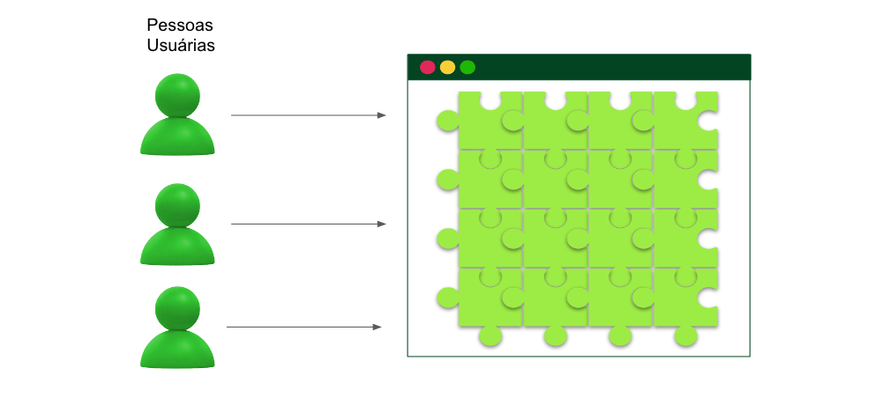
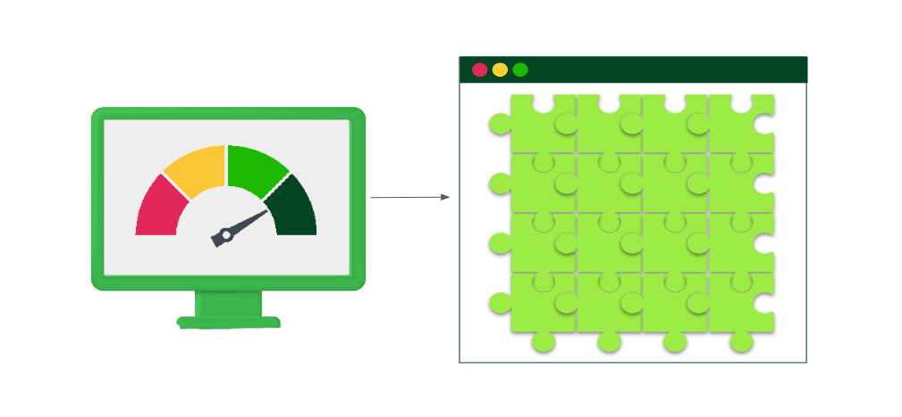

# 4.2 - Tipos de Testes

> Seção 4 - Testes da Aplicação · Lição 2 de 13

Testes são, em desenvolvimento de software, um conjunto de processos que avaliam funcionalidades, desempenho e qualidade de softwares. Os testes são a melhor forma de garantir o funcionamento do software a ser disponibilizado para um usuário final, identificando possíveis falhas ou defeitos no seu funcionamento.

Os testes automatizam o processo de validação da construção e das reformas de um software. Dessa forma, ao desenvolver uma aplicação, os testes garantem que todos os requisitos do projeto sejam atendidos e, caso alguma alteração seja realizada, garantem que essa alteração não tenha inutilizado alguma outra funcionalidade.

Existem diversos tipos de testes no ciclo de vida do desenvolvimento de um software. Alguns tipos importantes são:

## Testes de Unidade

Os testes de unidade são a primeira fase de um fluxo de testes. Estes são os testes que garantem que a menor unidade de software (função ou método) funcione de maneira isolada.

Os testes de unidade são executados repetidamente durante o desenvolvimento de software, sempre garantindo que a unidade lógica funcione em caso de refatoração e, por isso, ajudam na detecção precoce de erros. Estes testes acabam se tornando uma documentação `viva` de um software ou de uma funcionalidade, por interpretar o funcionamento das mesmas.

Como o teste de unidade verifica partes isoladas do software, ele requer dublês para todas as outras unidades de software das quais depende. Esses dublês são chamados de mocks, e eles simulam o comportamento e as respostas das unidades de software utilizadas pela unidade sob teste.

## Testes de Integração

Os testes de integração, diferentemente dos testes de unidade, são os testes que garantem o funcionamento de um grupo de camadas ou unidades de software que trabalham juntas. Estes testes acabam por testar diversas unidades juntas e verificam não só o funcionamento das mesmas, mas também se a comunicação, chamada e interação entre elas funciona de maneira correta.

Embora os testes de unidade garantam o funcionamento isolado, alguns problemas só podem ser detectados nos testes de integração, já que a ampla gama de dados testados pode revelar falhas na comunicação entre as camadas.

Nos testes de integração, os cenários reais são identificados, simulando de forma eficaz a interação do usuário com o software. No entanto, esses testes são mais complexos de criar, pois a configuração inicial deve ser simulada. Pela ausência de mocks, os testes de integração geralmente envolvem a simulação de componentes mais baixos do sistema, como bancos de dados, sistemas de arquivos e bibliotecas externas, enquanto as demais unidades de software são testadas em conjunto.

## Testes de Aceitação

Os testes de aceitação, também conhecidos como testes End to End (ponta a ponta), têm o objetivo de verificar se o software atende aos requisitos e expectativas das pessoas usuárias finais. Assim como os testes de integração, eles testam todas as camadas em conjunto, porém, nesse caso, o foco está na funcionalidade do software do ponto de vista das pessoas usuárias.

Devido ao envolvimento dos usuários finais nessa etapa, os testes de aceitação representam uma fase crítica no ciclo de desenvolvimento e são geralmente realizados na etapa final. A configuração do ambiente é complexa, pois, nesse tipo de teste, o ambiente precisa se assemelhar ao máximo ao ambiente de produção real.

## Testes de Performance

Os testes de performance são os testes que visam `estressar` um ambiente de produção a fim de medir o desempenho, a escalabilidade e a capacidade de resposta de um software quando submetido a diferentes condições de carga.

Este teste é realizado após os testes mencionados anteriormente e geralmente é executado próximo do lançamento do software, para validar o ambiente de produção. Os testes de performance também podem ser executados periodicamente para analisar a capacidade do software de se adaptar ao ambiente de produção.

