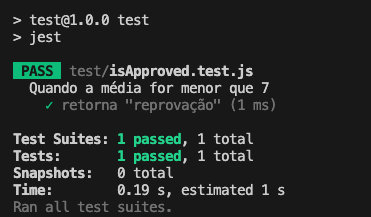
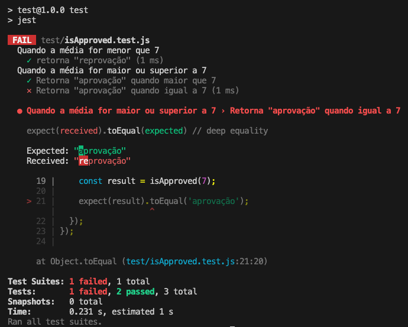

# 4.3 - Testes automatizados

> Seção 4 - Testes da Aplicação · Lição 3 de 13

Automatizar testes é uma necessidade tão presente no dia a dia dos times de desenvolvimento, que constantemente é tema de discussões e evoluções.

Hoje, testes automatizados são amplamente difundidos, com diversos tipos, técnicas e ferramentas disponíveis. Essa base sólida nos ajuda bastante durante o aprendizado, pois temos ferramentas consolidadas prontas para uso.

## Introdução ao Jest

O `Jest` é uma das ferramentas mais populares para testes em JavaScript. Embora tenha sido criado inicialmente para projetos React, o Jest funciona muito bem em diversos tipos de projetos JavaScript, incluindo Node.js. Ele é focado em testes de unidade, mas também oferece suporte a testes de integração e ponta a ponta (E2E).

Uma das principais vantagens do Jest é sua configuração simples, execução rápida e suporte a testes assíncronos. Além disso, ele pode ser configurado para rodar automaticamente quando detecta mudanças no código, tornando o ciclo de desenvolvimento mais ágil.

<details>
<summary>OBS da IA</summary>

**Alternativa mais moderna**

-   O Node tem test runner nativo estável (`node:test` + `node:assert`, Node 20+): `node --test`. **Vitest** é outra alternativa moderna com API compatível com Jest. Jest 29 continua amplamente usado — o conhecimento é transferível.

**Para o SAP CAP**

-   O CAP tem o `cds.test`, que sobe o servidor do projeto (com SQLite em memória) dentro do teste e funciona com Jest, Mocha ou `node --test`. Em versões recentes ele é instalado pelo pacote `@cap-js/cds-test`.

</details>

## Estruturando Testes com o Jest

Vamos criar uma função simples que verifica se uma pessoa foi aprovada com base em sua média de notas, seguindo a seguinte regra:


Agora, vamos configurar o nosso projeto:

1.  Crie uma pasta e dentro dessa pasta, execute os comandos:

```bash
mkdir test && touch isApproved.js && npm init -y
```

1.  Instale o Jest com:

```bash
npm install jest@29.7.0 --save-dev --save-exact
```

1.  Para habilitar o auto-complete de métodos do Jest, instale também o pacote de tipos:

```bash
npm install @types/jest@29.5.13 --save-dev --save-exact
```

Agora, vamos implementar a função `isApproved`, que recebe a média de notas e retorna se a pessoa foi aprovada ou reprovada:

```javascript
// isApproved.js
function isApproved(gradeAverage) {
  if (gradeAverage > 7) {
    return 'aprovação';
  }
  return 'reprovação';
}
module.exports = isApproved;
```

### Cenários de Teste

Precisamos cobrir três cenários principais:

-   Quando a média for menor que 7, a resposta deve ser "reprovação".
-   Quando a média for maior que 7, a resposta deve ser "aprovação".
-   Quando a média for igual a 7, a resposta deve ser "aprovação".

### Escopo Inicial dos Testes

Ao iniciar os testes no `Jest`, uma das primeiras funcionalidades que encontramos é o bloco `describe()`. Esse bloco desempenha um papel fundamental na organização dos testes, permitindo agrupar casos relacionados em um único escopo. Isso não apenas ajuda a manter o código de testes mais legível, mas também torna mais fácil identificar a área específica do código que está sendo testada.

O `describe()` aceita dois parâmetros principais:

1.  **Uma string:** Essa string é a descrição do grupo de testes, ou seja, ela deve descrever de forma clara o que aquele conjunto de testes está validando. Pense nela como o "título" do conjunto de testes.
2.  **Uma função:** Dentro dessa função, são definidos os testes relacionados ao comportamento que estamos validando. É aqui que cada caso de teste será detalhado.

Por exemplo, para testar um cenário onde a média de notas de um aluno é menor que 7, podemos criar dentro do arquivo `test/isApproved.test.js` o seguinte esqueleto de teste:

```javascript
// test/isApproved.test.js
describe('Quando a média for menor que 7', function () {
  //
});
```

Essa estrutura de `describe()` deixa nítido que estamos lidando com um cenário específico: notas que não atingem o valor mínimo de aprovação.

### Definindo o Comportamento com `test()`

Depois de organizar os cenários de teste com `describe()`, é hora de especificar o que queremos validar para cada cenário. Isso é feito com o método `test()`.

O `test()` também aceita dois parâmetros:

-   **Uma string:** Similar ao `describe()`, aqui descrevemos o comportamento que será testado, mas de forma mais detalhada e específica. Essa descrição deve explicar qual é o comportamento esperado da função para o cenário definido.
-   **Uma função:** Nessa função, colocamos a lógica do teste propriamente dita, verificando se o código está se comportando conforme o esperado.

Continuando com o nosso exemplo, podemos agora adicionar um caso de teste que verifica se, quando a média é menor que 7, a função retorna a palavra "reprovação":

```javascript
// test/isApproved.test.js
describe('Quando a média for menor que 7', function () {
  test('retorna "reprovação"', function () {
    //
  });
});
```

Aqui, estamos dizendo que, no cenário onde a média é menor que 7, esperamos que o retorno da função seja exatamente a string "**reprovação**".

### Adicionando Asserção

Agora que descrevemos o comportamento esperado, precisamos validar se a função está, de fato, retornando o valor correto. Para isso, utilizamos as **asserções**, que no Jest são fornecidas através do uso de `matchers`.

A asserção é onde validamos se o resultado gerado pelo código é igual ao que esperamos. No nosso caso, queremos garantir que, quando a média é inferior a 7, a função retorna "reprovação". Veja como isso funciona na prática:

```javascript
// test/isApproved.test.js
const isApproved = require('../isApproved');
// describe('Quando a média for menor que 7', function () {
//   test('retorna "reprovação"', function () {
    const result = isApproved(4);
    expect(result).toEqual('reprovação');
//   });
// });
```

Aqui estamos utilizando o ***matcher*** `toEqual()` do Jest para afirmar que o valor retornado pela função `isApproved()` deve ser igual à string "reprovação" quando a média fornecida é `4`.

> **De olho na dica👀:** O *matcher* `toEqual` é um dos diversos *matchers* disponíveis no \`Jest. Você pode acessar a lista completa na [documentação oficial do Jest](https://jestjs.io/docs/expect).

### Executando os Testes

Para executarmos os testes, altere o `script` de **test** no `package.json` para o seguinte:

```json
  "scripts": {
    "test": "jest"
  },
```

Pronto, agora só precisamos executar os testes com o comando `npm test` para termos a resposta do teste igual à imagem abaixo.



### Testando os outros Cenários

Agora que já configuramos e validamos o cenário em que a média é menor que 7, podemos expandir nossos testes para cobrir os outros dois casos restantes:

1.  Quando a média é maior que 7, a resposta deve ser "aprovação".
2.  Quando a média é exatamente 7, a resposta também deve ser "aprovação".

Vamos adicionar esses testes no mesmo arquivo para garantir que todas as condições estejam sendo tratadas corretamente. O código a seguir demonstra como testar esses dois cenários:

```javascript
// test/isApproved.test.js
const isApproved = require('../isApproved');
// describe('Quando a média for menor que 7', function () {
//   test('retorna "reprovação"', function () {
//     const result = isApproved(4);
//     expect(result).toEqual('reprovação');
//   });
// });
describe('Quando a média for maior ou igual a 7', function () {
  test('retorna "aprovação"', function () {
    const result = isApproved(9);
    expect(result).toEqual('aprovação');
  });
  test('retorna "aprovação"', function () {
    const result = isApproved(7);
    expect(result).toEqual('aprovação');
  });
});
```

Aqui estamos verificando duas situações diferentes, mas que devem resultar no mesmo comportamento: a função `isApproved()` deve retornar "aprovação" tanto quando a média é maior que 7, quanto quando é exatamente 7.

### Analisando Resultados

Com os novos cenários implementados, você pode executar novamente os testes. Após a execução, você verá algo semelhante à imagem abaixo:



Note que, na execução dos testes, um deles falhou quando o valor da média passada é `7`. Nesse caso, o retorno esperado seria "aprovação", mas a função está retornando "reprovação". O Jest fornece uma mensagem indicando a falha, o que facilita a identificação do problema.

Ao receber uma mensagem de erro como essa, podemos revisar a implementação da função `isApproved()`. Logo, identificamos que ela não está lidando corretamente com a média igual a `7`. Para corrigir isso, basta ajustar a condição na função, como mostrado abaixo:

```javascript
// isApproved.js
// function isApproved(gradeAverage) {
  if (gradeAverage >= 7) { // Corrigimos aqui o sinal de igualdade para incluir o 7
//     return 'aprovação';
//   }
//   return 'reprovação';
// }
// module.exports = isApproved;
```

Agora, ao executar os testes novamente, o erro será resolvido, e todos os cenários deverão passar corretamente.

Para consolidar os conceitos sobre testes, assista ao vídeo a seguir:

> **Vídeo da aula:** [assistir online](https://player.vimeo.com/video/1022293737)

<details>
<summary>OBS da IA</summary>

**CI/CD**

-   Testes automatizados rendem mais quando rodam **sozinhos a cada pull request**, antes do merge. Isso é a CI. Sem ela, os testes dependem de alguém lembrar de rodá-los.
-   Veja [IA.3 - GitHub Actions: o primeiro pipeline de CI](../12%20-%20OBS%20da%20IA%20-%20CI-CD%20-%20o%20m%C3%ADnimo%20para%20deploy%20automatizado/03%20-%20GitHub%20Actions%20-%20o%20primeiro%20pipeline%20de%20CI.md).

</details>
