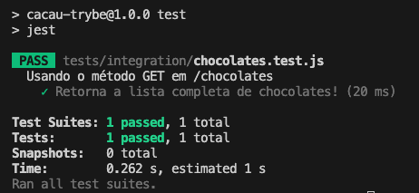

# 4.7 - Testes de Integração com Supertest

> Seção 4 - Testes da Aplicação · Lição 7 de 13

Dando continuidade ao nosso cenário de testes de integração com base no contrato da API, vamos implementar nossos testes usando Jest e Supertest.

Na última lição, criamos a rota `GET /chocolates`, e agora usaremos essa rota para realizar nossos testes de integração.

## Supertest

Supertest é uma biblioteca que facilita a criação de testes para APIs, fornecendo uma maneira simples de enviar requisições HTTP diretamente para o app sem a necessidade de levantar um servidor manualmente. Com ele, podemos testar rotas e verificar se as respostas estão de acordo com o esperado.

<details>
<summary>OBS da IA</summary>

**Alternativa mais moderna**

-   O `@types/jest` só serve para autocompletar no editor quando o projeto é JS puro.

**Para o SAP CAP**

-   No CAP o `cds.test` substitui o supertest: ele devolve clientes HTTP prontos.

```javascript
const cds = require('@sap/cds');

const { GET, POST, expect } = cds.test(__dirname + '/..');

test('lista os times', async () => {
  const { status, data } = await GET('/odata/v4/teams/Teams');
  expect(status).to.equal(200);
  expect(data.value).to.have.length(3);
});
```

</details>

## Instalação do Jest e Supertest

Para começar, vamos instalar as bibliotecas Jest e Supertest:

```bash
npm install --save-dev --save-exact jest@29.7.0 supertest@7.0.0 @types/jest@29.5.13
```

Depois, vamos ajustar o `package.json` para que o comando de testes funcione corretamente:

```json
"scripts": {
  "test": "jest"
}
```

Com isso, estamos prontos para transformar os contratos da nossa API em cenários de teste. Vamos agora criar o primeiro teste de integração.

## Escrevendo o Primeiro Teste

Começaremos pela rota `GET /chocolates` que retorna a lista completa de chocolates.

```javascript
// tests/integration/chocolates.test.js

const request = require('supertest');
const app = require('../../src/app');

describe('Usando o método GET em /chocolates', () => {
  test('Retorna a lista completa de chocolates!', async () => {
    const response = await request(app)
      .get('/chocolates')
      .expect(200);

  });
});
```

### Entendendo o Código

1.  **`require('supertest')`:** O Supertest nos permite simular requisições HTTP diretamente no app Express, sem a necessidade de subir o servidor manualmente. Em outras palavras, Supertest cria seu próprio `listen()`  
    
2.  **`require('../../src/app')`:** Aqui estamos importando a aplicação que criamos no app.js. Como o Supertest utiliza o app diretamente, não precisamos inicializar o servidor para fazer os testes.  
    
3.  **`describe`** e **`test`:** A estrutura de `describe` e `test` é a mesma que usamos com Jest, organizando os testes por grupos e criando casos de teste específicos.  
    
4.  **`request(app).get('/chocolates').expect(200)`:** Esse trecho faz a requisição `GET` para o endpoint `/chocolates` (`get('/chocolates')`) e verifica se o status da resposta é `200 - OK` (`expect(200)`).  
    

> **De olho na dica 👀:** Poderíamos também testar o status da resposta, seguindo este outro formato `expect(response.status).toBe(200);`.

## Executando o Teste

Agora, execute o teste com o comando `npm test`. Se tudo estiver correto, o teste deverá passar, retornando um status `200` da nossa API. O resultado será algo parecido com a imagem abaixo:



## Verificando o Conteúdo da Resposta

No teste acima, você pode ter percebido que verificamos apenas o status da resposta. Agora, vamos garantir que os dados retornados também estão corretos:

```javascript
// tests/integration/chocolates.test.js

const request = require('supertest');
const app = require('../../src/app');

// describe('Usando o método GET em /chocolates', () => {
//   test('Retorna a lista completa de chocolates!', async () => {
    const resultExpected = {
      chocolates: [
        { id: 1, name: 'Mint Intense', brandId: 1 },
        { id: 2, name: 'White Coconut', brandId: 1 },
        { id: 3, name: 'Mon Chéri', brandId: 2 },
        { id: 4, name: 'Mounds', brandId: 3 },
      ]
    };

    // const response = await request(app)
    //   .get('/chocolates')
    //   .expect(200);

    expect(response.body).toEqual(resultExpected);
//   });
// });
```

### Entendendo as Alterações

1.  **`resultExpected`:** Essa constante define o resultado esperado da requisição, com a lista de chocolates.  
    
2.  **`expect`:** Estamos verificando se o corpo da resposta do endpoint (`response.body`) corresponde exatamente à nossa lista de chocolates (`resultExpected`).  
    

Agora execute novamente os testes com o comando `npm test` e observe que, além do status `200`, também estamos validando os dados retornados pela API.
