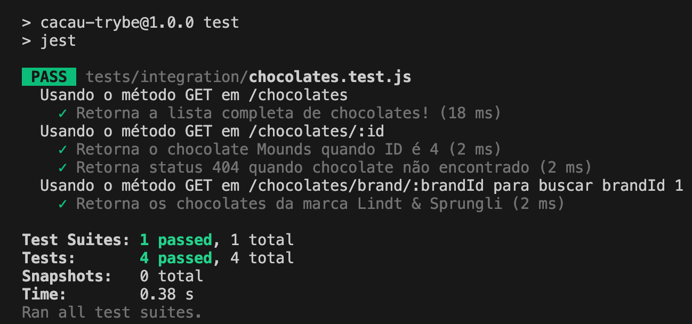

# 4.8 - Testando Novos Cenários

> Seção 4 - Testes da Aplicação · Lição 8 de 13

Vamos agora expandir nossa aplicação com novas rotas e incluir os testes para validá-las.

## Adicionando novas Rotas

Vamos adicionar as rotas `GET /chocolates/:id` e `GET /chocolates/brand/:brandId`:

```javascript
// src/app.js

// ... Restante do código

app.get('/chocolates/:id', async (req, res) => {
  const { id } = req.params;

  const cacauFile = await readCacauTrybeFile();
  const findChocolate = cacauFile.chocolates.find((chocolate) => chocolate.id === Number(id));

  if (!findChocolate) return res.status(404).json({ message: 'Chocolate Not Found!' });

  return res.status(200).json({ chocolate: findChocolate });
});

app.get('/chocolates/brand/:brandId', async (req, res) => {
  const { brandId } = req.params;

  const cacauFile = await readCacauTrybeFile();

  const findChocolatesByBrand = cacauFile.chocolates
    .filter((chocolate) => chocolate.brandId === Number(brandId));

  return res.status(200).json({ chocolates: findChocolatesByBrand });
});

// module.exports = app;
```

> **De olho na dica 👀:** Analise o código com atenção para entender como as rotas estão estruturadas. Em seguida, faça requisições usando um API Client para conferir os resultados.

## Testando as Novas Rotas

Agora, vamos construir testes para essas novas rotas:

```javascript
// tests/integration/chocolates.test.js

// ... Restante do código

describe('Usando o método GET em /chocolates/:id', () => {
  test('Retorna o chocolate Mounds quando ID é 4', async () => {
    const response = await request(app)
      .get('/chocolates/4')
      .expect(200);

    expect(response.body.chocolate).toEqual(
      {
        id: 4,
        name: 'Mounds',
        brandId: 3,
      });
  });

  test('Retorna status 404 quando o chocolate não é encontrado', async () => {
    const response = await request(app)
      .get('/chocolates/99')
      .expect(404)

    expect(response.body).toEqual({ message: 'Chocolate Not Found!' })
  });
});

describe('Usando o método GET em /chocolates/brand/:brandId para buscar brandId 1', () => {
  test('Retorna os chocolates da marca Lindt & Sprungli', async () => {
    const resultExpected = [
      { id: 1, name: 'Mint Intense', brandId: 1 },
      { id: 2, name: 'White Coconut', brandId: 1 },
    ];

    const response = await request(app)
      .get('/chocolates/brand/1')
      .expect(200);

    expect(response.body.chocolates).toEqual(resultExpected);
  });
});
```

Confira que praticamente os nossos testes se mantiveram os mesmos, mas podemos destacar dois pontos:

1.  O `.get()` varia de acordo com a rota testada, refletindo as especificidades de cada cenário.
2.  Quando utilizamos o `response.body`, podemos validar o conteúdo da resposta acessando a chave específica esperada para cada teste. No último teste, acessamos a chave utilizando esse formato `response.body.chocolates`.

Agora, execute os testes com `npm test` e confira os resultados detalhados de cada um dos cenários.



Para fixar os conceitos sobre testes de integração, assista ao vídeo a seguir:

> **Vídeo da aula:** [assistir online](https://player.vimeo.com/video/1022293764)
