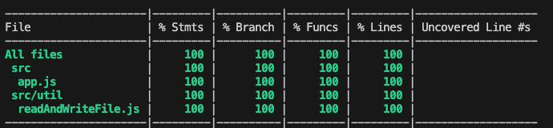
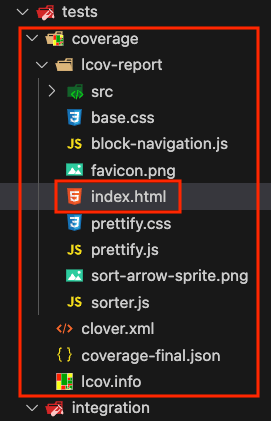
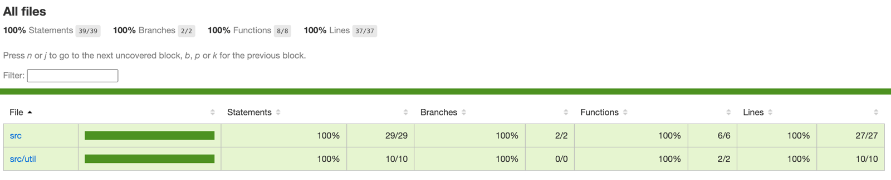

# 4.10 - Configurações do Jest

> Seção 4 - Testes da Aplicação · Lição 10 de 13

Agora que já temos um projeto pequeno com testes, vamos explorar algumas dicas que podem facilitar o desenvolvimento em projetos maiores. Em cenários assim, as configurações do Jest se tornam essenciais.

## .only e .skip

Até o momento, ao rodarmos os testes, todos eles são executados. No entanto, podemos ter mais controle sobre isso com dois recursos: `.only()` e `.skip()`.

1.  `.only()` permite que apenas um teste ou um conjunto específico seja executado, ignorando os demais.

Você pode usá-lo tanto no `describe()` quanto no `test()`, como mostrado nos exemplos abaixo:

-   `describe()`: executa todos os testes dentro do bloco `describe()` marcado com `.only`.

```javascript
// Adiciona .only
describe.only('Usando o método GET em /chocolates/brand/:brandId para buscar brandId 1', () => {
  test('Retorna os chocolates da marca Lindt & Sprungli', async () => {
    // Lógica do teste
  });
});
```

-   `test()`: executa apenas o teste marcado com `.only`, ignorando outros testes dentro do `describe()`.

```javascript
describe('Usando o método GET em /chocolates/:id', () => {
  // Adiciona .only
  test.only('Retorna o chocolate Mounds quando ID é 4', async () => {
    // Lógica do teste
  });
  test('Retorna status 404 quando chocolate não encontrado', async () => {
    // Lógica do teste
  });
});
```

1.  `.skip()` é o inverso de `.only()`, e serve para pular testes específicos, ignorando-os na execução. É utilizado da mesma forma que o `.only`.

## jest.config.js

O `jest.config.js` é o arquivo que centraliza as configurações do Jest. Ele permite customizar o comportamento dos testes conforme as necessidades do projeto. Abaixo, vamos ver como criar esse arquivo e algumas configurações básicas:

```javascript
// jest.config.js
/** @type {import('jest').Config} */
module.exports = {
  rootDir: './tests',
  testMatch: ['<rootDir>/integration/*.test.js'],
  testTimeout: 10000,
  testEnvironment: 'node',
};
```

-   `/** @type {import('jest').Config} */`: adiciona suporte a **autocomplete** e verificação de tipos no arquivo de configuração.
-   `rootDir`: Define o diretório raiz para a execução dos testes, ajudando a padronizar o uso de caminhos relativos no projeto (O próximo comando considera essa configuração).
-   `testMatch`: Especifica quais arquivos de teste devem ser executados. No exemplo, o Jest buscará por arquivos com a extensão `.test.js` na pasta `integration`.
-   `testTimeout`: Permite ajustar o tempo máximo que o Jest deve aguardar para finalizar cada teste. O valor padrão é 5000ms (5 segundos), mas em testes mais complexos pode ser necessário aumentá-lo.
-   `testEnvironment`: Define o ambiente de execução dos testes. Aqui configuramos para node, o que evita que o Jest tente acessar recursos do navegador, como `document` ou `window`, devido à configuração padrão.

## Cobertura de Código (`Coverage`)

Cobertura de código é uma métrica que indica quais partes do código estão sendo testadas. Ela ajuda a identificar áreas que ainda precisam de mais testes, mas lembre-se: uma cobertura alta não garante que os testes sejam suficientes ou de alta qualidade.

Existem várias ferramentas para verificar a cobertura de código. Em termos gerais, esses resultados podem evidenciar:

-   A proporção de linhas do código que é executada durante os testes;
-   Se existem linhas que nunca serão executadas (como em condições mal estruturadas de `if/else`);
-   A quantidade de funções externas que são chamadas;
-   Blocos de código repetitivos e/ou inalcançáveis.

Para ativar a cobertura de código, adicione a configuração `collectCoverage` no arquivo `jest.config.js`:

```javascript
// jest.config.js
// /** @type {import('jest').Config} */
// module.exports = {
//   rootDir: './tests',
//   testMatch: ['<rootDir>/integration/*.test.js'],
//   testTimeout: 10000,
//   testEnvironment: 'node',
  collectCoverage: true,
// };
```

Depois de executar os testes novamente, uma tabela como a seguinte aparecerá no seu terminal

 Teste Cobrindo 100% do Código!

Sabendo que a imagem acima indica que estamos cobrindo 100% do nosso código com testes, vamos entender o que cada coluna significa:

<table><tbody><tr><td>Termo</td><td>Descrição</td></tr><tr><td>File</td><td>Lista todos os arquivos da aplicação que estão sendo testados.</td></tr><tr><td>% Stmts</td><td>Abreviação de _statements_, indica a porcentagem de declarações testadas.</td></tr><tr><td>% Branch</td><td>Exibe a porcentagem de ramificações do código (como em condicionais `if/else`) que está sendo coberta pelos testes.</td></tr><tr><td>% Funcs</td><td>Exibe a porcentagem de funções que estão sendo testadas.</td></tr><tr><td>% Lines</td><td>Exibe a porcentagem de linhas cobertas pelos testes.</td></tr><tr><td>Uncovered Line #s</td><td>Exibe as linhas do arquivo que não estão sendo testadas. Caso a cobertura seja de 100%, essa coluna estará vazia.</td></tr></tbody></table>

Além disso, ao rodar os testes será gerada uma pasta chamada `coverage` dentro da pasta de `tests`. Essa pasta contém diversas informações sobre a cobertura, incluindo um arquivo `index.html` que exibe os dados de maneira visual e interativa. Veja a imagem abaixo:



Para visualizar esse relatório interativo, você pode utilizar uma extensão como o `Live Server` no VS Code ou simplesmente arrastar o arquivo `index.html` para o seu navegador. Isso abrirá uma nova aba com o seguinte visual:



Agora é com você! Explore as funcionalidades no seu navegador para obter *insights* sobre sua cobertura de testes.

> **Anota aí 🖊:** Não é uma boa prática enviar a pasta `coverage` ao seu repositório Git. Lembre-se de adicioná-la ao `.gitignore` para que ela não seja incluída nos commits.

### Configurações adicionais do `Coverage`

Vamos explorar mais algumas configurações para personalizar a geração da cobertura de código:

```javascript
// jest.config.js
// /** @type {import('jest').Config} */
// module.exports = {
//   rootDir: './tests',
//   testMatch: ['<rootDir>/integration/*.test.js'],
//   testTimeout: 10000,
//   testEnvironment: 'node',
//   collectCoverage: true,
  coverageDirectory: '../novo-coverage',
  coverageReporters: ['html', 'text'],
  coveragePathIgnorePatterns: ['/node_modules/', '/tests/'],
  coverageThreshold: {
    global: {
      branches: 80,
      functions: 80,
      lines: 80,
      statements: 80,
    },
  },
// };
```

-   `coverageDirectory`: Define o local onde o Jest irá gerar o relatório de cobertura considerando o arquivo `rootDir` (no nosso caso dentro da pasta `tests`). Com esta opção também podemos escolher o nome do arquivo em que será gerado o `coverage` (ex: `novo-coverage`).
-   `coverageReporters`: Escolhe os formatos dos relatórios de cobertura gerados na pasta `coverage` e no terminal. No exemplo, teremos uma versão em HTML e outra em texto no terminal. O valor padrão inclui `["clover", "json", "lcov", "text"]`.
-   `coveragePathIgnorePatterns`: Exclui certos diretórios da análise de cobertura, como `node_modules` e a própria pasta de testes.
-   `coverageThreshold`: Estabelece metas mínimas para a cobertura de testes. No exemplo, configuramos uma cobertura mínima de 80% para ramificações, funções, linhas e declarações.

Para mais opções de configuração, consulte a [documentação oficial do Jest](https://jestjs.io/pt-BR/docs/configuration#coveragepathignorepatterns-arraystring).

<details>
<summary>OBS da IA</summary>

**Alternativa mais moderna**

-   Com o runner nativo, a cobertura sai com `node --test --experimental-test-coverage`. As opções de Jest mostradas na lição continuam válidas.

</details>

<details>
<summary>OBS da IA</summary>

**CI/CD**

-   Com `coverageThreshold` no `jest.config.js`, o Jest **falha** se a cobertura cair abaixo do mínimo, e o pipeline bloqueia o merge.
-   Cuidado com `.only` esquecido: no pipeline, só aquele teste roda e o resto passa "verde" sem ter sido executado. Uma regra de lint (`jest/no-focused-tests`) evita isso.
-   Veja [IA.2 - Preparando o projeto para a CI](../12%20-%20OBS%20da%20IA%20-%20CI-CD%20-%20o%20m%C3%ADnimo%20para%20deploy%20automatizado/02%20-%20Preparando%20o%20projeto%20para%20a%20CI.md).

</details>
