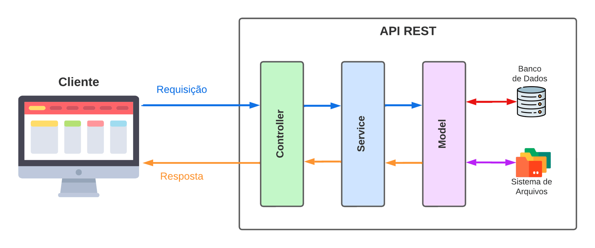

# 6.3 - Arquitetura em Camadas: Model, Service e Controller

> Seção 6 - Design Modular com Arquitetura em Camadas · Lição 3 de 19

Vamos aplicar a Arquitetura em Camadas para organizar nosso código. Usando a analogia das gavetas, aqui cada camada representa uma "gaveta" onde guardamos partes do código com uma responsabilidade bem definida. Em nosso exemplo, teremos três camadas principais: `Model`, `Service` e `Controller`.

A figura a seguir representa a organização das camadas.

 Visão da arquitetura em camadas dividida entre: Model, Service e Controller

## Camada Model

A camada **Model** é onde o código relacionado ao acesso a dados é agrupado. Imagine uma gaveta onde você armazena todas as ferramentas que interagem diretamente com um banco de dados ou com arquivos de dados. Na prática, a camada Model contém funções responsáveis por ler e escrever dados em um banco de dados (como MySQL) ou até em sistemas de arquivos.

**Exemplo prático**: Se nossa aplicação for uma loja virtual, a camada Model irá conter funções para adicionar novos produtos, atualizar preços, consultar o estoque e remover itens. A Model atua como uma ponte entre a aplicação e o local onde os dados estão armazenados, garantindo que as informações sejam recuperadas e salvas corretamente.

## Camada Service

A camada **Service** é onde as **regras de negócio** da aplicação são definidas. Pense nela como uma gaveta que agrupa as instruções sobre o funcionamento interno do sistema. Aqui, é onde as lógicas de "como" e "quando" uma operação deve acontecer são aplicadas.

**Exemplo prático**: Voltando ao exemplo da loja virtual, a camada Service pode conter uma função que calcula descontos promocionais. Suponha que o site oferece um desconto de 10% para compras acima de R$100,00. A camada Service cuidará dessa regra de negócio, verificando o valor do pedido e aplicando o desconto quando necessário, sem precisar se preocupar com os detalhes de como o pedido será armazenado no banco de dados.

## Camada Controller

Por fim, temos a camada Controller, responsável pela interação entre o usuário e a aplicação. Essa camada atua como a interface entre as requisições externas e o sistema interno, validando as informações recebidas e repassando-as às camadas adequadas.

**Exemplo prático**: Na loja virtual, ao receber uma requisição de cadastro de produto, o Controller é responsável por receber os dados do produto enviados pelo cliente (via uma requisição HTTP, por exemplo), validar esses dados, e então encaminhar a solicitação à camada Service para aplicar qualquer regra de negócio (como aplicar impostos ou verificar disponibilidade) e, finalmente, pedir à camada Model para armazenar o produto no banco de dados.

OBS da IA

**Para o SAP CAP**

-   Mapeamento para o CAP: **Model** → entidades CDS em `db/*.cds`; **Service** → definição em `srv/*.cds` (projeções) + regras de negócio em `srv/*.js`; **Controller** → não existe, os adaptadores de protocolo do CAP (OData/REST) recebem a requisição e montam a resposta.
-   Os ganchos `before` (validar/rejeitar), `on` (substituir a implementação) e `after` (enriquecer o resultado) substituem a maior parte do código das três camadas.

