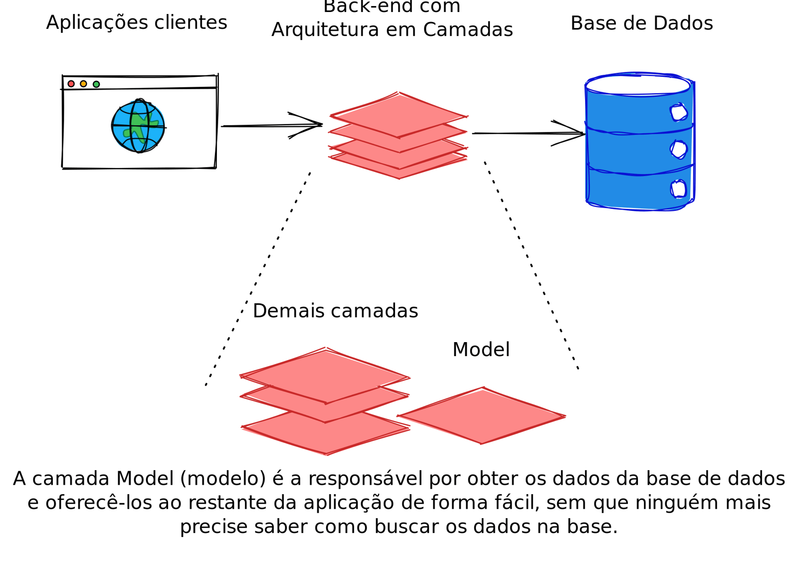

# 6.4 - Camada Model

> Seção 6 - Design Modular com Arquitetura em Camadas · Lição 4 de 19

## Qual é a responsabilidade da camada Model?

No contexto de uma API Back-end, a camada Model é responsável pela comunicação direta com o banco de dados, facilitando o armazenamento, consulta e manipulação de dados. Ela atua como uma ponte entre o banco e as outras camadas da aplicação, centralizando essas operações para manter o código organizado e escalável. Em vez de executar consultas SQL diretamente em arquivos iniciais, como o `index.js`, a camada Model é responsável por abstrair a interação com o banco de dados, garantindo que outras partes do sistema não precisem conhecer os detalhes dessa interação.

Por exemplo, quando implementamos a funcionalidade de **listar todas as pessoas cadastradas**, estamos realizando uma operação de leitura de dados, que será tratada de forma organizada na camada Model.

 A camada de Model é a responsável por obter os dados da base e oferecê-los de forma simples para o restante da aplicação

## Como organizar a camada Model?

Na prática, a camada *Model* será estruturada dentro de um diretório específico no diretório `src` da aplicação, como `src/models/`. No entanto, ao criarmos esse diretório, surge a dúvida: como vamos organizar os arquivos aqui dentro? Em projetos grandes, uma prática comum é criar um arquivo para cada tabela do banco de dados. Dessa forma, cada arquivo *Model* terá uma responsabilidade bem definida: manipular dados de uma tabela específica.

**Em resumo**:

-   Cada **arquivo Model** representa uma parte específica do banco de dados (geralmente, uma tabela);
-   Cada Model organiza, "empacota" e entrega os dados de forma que outras partes da aplicação possam acessá-los facilmente.

## Sistema de Gestão Escolar: Adicionando a Camada Model

Agora, vamos retomar o projeto **Sistema de Gestão Escolar** e expandi-lo, adicionando a camada Model para centralizar as operações do banco de dados.

Antes, já estávamos utilizando uma estrutura similar ao de um Model, mas não havíamos adotado o nome `Model` para o diretório e nem para o arquivo. Vamos refatorar o projeto para seguir essa convenção.

> **Relembrando 🧠:** O código apresentado no conteúdo, pode ser acessado na pasta `06-design-modular-com-arquitetura-em-camadas/parte-01-inicio` ou através desse **[link](https://github.com/learnwithtrybe/node-codigos/tree/main/06-design-modular-com-arquitetura-em-camadas/parte-01-inicio)**.

### Reestruturação do Projeto

1.  **Renomeação de Pastas e Arquivos**: Para mantermos o padrão de nomenclatura, siga os passos abaixo para que a camada Model fique bem definida:
2.  Renomeie a pasta `src/database` para `src/model`.
3.  Renomeie o arquivo `src/model/studentsDB.js` para `src/model/studentModel.js`.
4.  **Ajuste as importações**: Atualize todas as importações para refletirem a nova estrutura:

```javascript
// tests/integration/studentRoutes.test.js
// const request = require('supertest');
// const app = require('../../src/app');
const connection = require('../../src/model/connection');
// const { studentMock, studentByIdMock } = require('./mocks/studentMocks');
jest.mock('../../src/model/connection');
```

```javascript
// tests/integration/studentRoutesSpy.test.js
// const request = require('supertest');
// const app = require('../../src/app');
const connection = require('../../src/model/connection');
```

No arquivo `src/routes/studentRoutes.js` modifique a importação e o nome da constante:

```javascript
// src/routes/studentRoutes.js
// const express = require('express');
const studentModel = require('../model/studentModel');
// router.get('/', async (_req, res) => {
//   try {
    const students = await studentModel.findAll();
//     return res.status(200).json(students);
//   } catch (err) {
//     console.log(err.sqlMessage);
//     return res.status(500).json({ message: 'Internal Server Error!' });
//   }
// });
```

> **Atenção ⚠️:** Todos os locais que utilizavam a constante `studentsDB` agora devem referenciar `studentModel`, como mostrado no exemplo acima.

1.  **Remover teste de conexão com MySQL**: No arquivo `server.js` remova toda conexão que é feita para testar o funcionamento do MySQL.

```javascript
const app = require('./app');
const PORT = process.env.PORT || 3001;
app.listen(PORT, async () => {
  console.log(`Server running on port ${PORT}`);
});
```

1.  **Verificação de Funcionamento**: Após realizar as refatorações, execute `npm run dev` para conferir se tudo está funcionando sem erros.

## Formatando dados da `Model`

Ao retornar dados diretamente do banco, a nomenclatura utilizada frequentemente segue o padrão `snake_case` (como a chave `birth_date`). Para ajustar os dados ao padrão `camelCase` utilizado em JavaScript, vamos utilizar o módulo `camelize`, que automatiza essa conversão.

### Instalando e Configurando camelize

1.  Instale o módulo `camelize`:

```bash
npm install camelize@1.0.1 -E
```

1.  **Adicionando camelize ao Model**: Modifique o `studentModel.js` para converter os dados automaticamente para `camelCase`:

```javascript
// src/model/studentModel.js
const camelize = require('camelize');
// const conn = require('./connection');
// const findAll = async () => {
//   const [result] = await conn.execute('SELECT * FROM students;');
  return camelize(result);
// };
// const findById = async (id) => {
//   const [result] = await conn.execute('SELECT * FROM students WHERE id = ?;', [id]);
  return camelize(result[0]);
// };
```

Com o `camelize`, um retorno que antes teria o formato:

```json
  {
    "id": 1,
    "name": "Ana Souza",
    "cpf": "123.456.789-01",
    "birth_date": "2000-05-14T03:00:00.000Z", // campo que será alterado
    "email": "ana.souza@example.com",
    "cep": "01000-000",
    "address": "Rua A, Bairro B, Cidade C - SP"
  },
```

Será convertido automaticamente para `camelCase`, resultando em:

```json
  {
    "id": 1,
    "name": "Ana Souza",
    "cpf": "123.456.789-01",
    "birthDate": "2000-05-14T03:00:00.000Z", // campo alterado para camelCase
    "email": "ana.souza@example.com",
    "cep": "01000-000",
    "address": "Rua A, Bairro B, Cidade C - SP"
  },
```

Essa padronização facilita o trabalho com os dados nas demais camadas da aplicação, mantendo a consistência e alinhamento com o padrão de nomenclatura do JavaScript.

> **Atenção ⚠️:** Os testes agora apresentarão falhas, pois alteramos o formato de retorno da nossa API. Para corrigir, abra o arquivo `tests/integration/mocks/studentMocks.js` e adicione **novos mocks** com a chave `birthDate` (diferente da chave `birth_date`).

<details>
<summary>OBS da IA</summary>

**Alternativa mais moderna**

-   Sem biblioteca extra, dá para resolver o snake\_case com alias no próprio SQL (`SELECT birth_date AS birthDate`).

**Para o SAP CAP**

-   No CAP não há conversão manual: os nomes vêm do CDS e o framework gera as tabelas/colunas a partir dele. `camelize` não é necessário.

</details>
