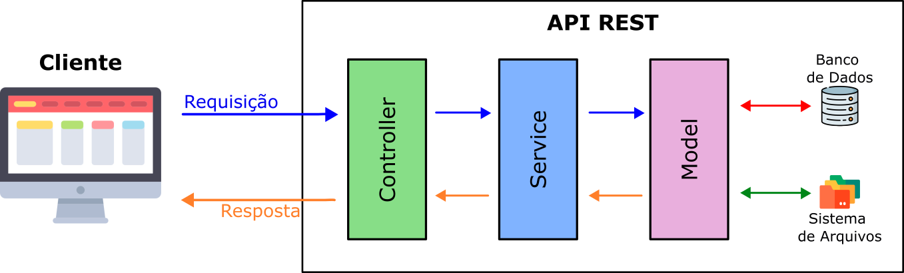

# 6.5 - Camada Controller

> Seção 6 - Design Modular com Arquitetura em Camadas · Lição 5 de 19

A camada Controller desempenha um papel fundamental em qualquer aplicação. Ela é responsável por receber e responder adequadamente às requisições feitas por diferentes dispositivos — sejam aplicações *React*, *Android*, *iOS*, ou mesmo dispositivos *desktop*. Essas requisições podem carregar dados no *body*, *query* ou *params*, e a resposta geralmente é em formato JSON, que é o padrão mais comum no mercado.

Quando uma aplicação faz uma requisição para a API, espera-se que os dados enviados estejam corretos e validados. Contudo, é essencial que o time responsável pelo desenvolvimento back-end assuma uma postura de cautela em relação a esses dados. Afinal, pessoas com intenções maliciosas podem enviar dados incorretos ou alterados, com a finalidade de explorar possíveis falhas de segurança na aplicação.

Assim, validar os dados de entrada em cada requisição é uma etapa crítica no desenvolvimento de APIs, garantindo que tudo o que a aplicação precisa para processar a requisição esteja presente.

> **Para refletir 💭**: "Qual a função das validações na camada Controller e como elas se relacionam com a segurança da aplicação?"

As validações na camada Controller garantem que todos os dados necessários estejam presentes na requisição e estejam em um formato aceitável. Isso é especialmente importante para evitar erros e assegurar que a API consiga processar as requisições de forma segura.

Em muitos casos, podemos organizar essas validações de entrada em `middlewares` específicos, que atuam antes mesmo da lógica principal na Controller. O uso de middlewares ajuda a estruturar a aplicação e tornar o código da Controller mais legível e conciso, concentrando as verificações em pontos específicos.

Por exemplo, se estamos desenvolvendo um endpoint de cadastro, podemos criar um middleware que valida a presença de campos obrigatórios, como `email` e `senha`, e depois passá-los para a Controller. Caso algum campo essencial esteja ausente, o middleware já responde com um erro 400, informando a falta de dados necessários para o cadastro.

> **De olho na dica 👀**: Alguns desenvolvedores podem preferir que certas validações (por exemplo, verificar se uma string está em formato de email) sejam feitas na Controller, enquanto outros preferem realizar isso em camadas subsequentes. Lembre-se de que a arquitetura de uma aplicação envolve escolhas que variam conforme o contexto do projeto e do time. Não há uma regra única, e adaptar as práticas de acordo com o cenário é comum.

Além de garantir a integridade dos dados recebidos, a camada Controller é responsável por direcionar os dados para as camadas seguintes da aplicação, seguindo o fluxo arquitetural.

Modelo arquitetural em camadas

Quando uma requisição chega, a Controller é a primeira camada a recebê-la. Em seguida, ela processa os dados e encaminha as informações para as camadas que farão o tratamento específico da solicitação. Se o endpoint requisitado envolve manipulação de dados no banco, a Controller poderá fazer a chamada para a camada Model ou outra camada, que estará encarregada de executar essa operação.

## Responsabilidade pelas Respostas da API

Uma vez que a camada Controller conclui a validação e tratamento dos dados, é seu papel responder à requisição. Essa resposta pode indicar sucesso (com o código HTTP apropriado, como 200 ou 201) ou comunicar um erro, incluindo a razão para ele.

Existem dois tipos principais de erro que a Controller pode responder:

1.  **Erros originados pelo cliente**: Estes ocorrem quando os dados enviados estão incompletos, ausentes ou incorretos. Nesses casos, a Controller pode responder com uma mensagem indicando o erro e um código de status apropriado, como 400 (Bad Request).
2.  **Erros originados pela REST API**: Estes erros geralmente se devem a problemas internos, como indisponibilidade do banco de dados ou falha no servidor. Nesses casos, a resposta ao cliente é mais genérica e evita expor detalhes técnicos que poderiam ser explorados, retornando um status 500.

Ao retornar respostas genéricas para erros internos, a Controller protege a aplicação, evitando que detalhes internos sejam expostos e possam ser usados em ataques. Afinal, quanto menos informações técnicas a API expõe, menor é a chance de um atacante conseguir explorar vulnerabilidades.

## Sistema de Gestão Escolar: Adicionando a Camada Controller

### Criando o Arquivo Controller

Para iniciar, precisamos criar o arquivo `studentController.js` dentro de uma nova pasta `src/controller`. Esse arquivo será responsável por conter todas as operações de CRUD relacionadas aos estudantes, que antes estavam diretamente no arquivo de rotas `studentRoutes.js`.

1.  Crie o arquivo `studentController.js` dentro do diretório `controller`.
2.  Transfira e adapte as funções de manipulação de dados dos estudantes para esse arquivo, garantindo que as operações estejam corretamente conectadas ao Model.

Aqui está o código completo do arquivo `studentController.js` após a refatoração:

```javascript
// src/controller/studentController.js
const studentModel = require('../model/studentModel');
const INTERNAL_SERVER_ERROR = 'Internal Server Error!';
const getAllStudents = async (_req, res) => {
  try {
    const students = await studentModel.findAll();
    return res.status(200).json(students);
  } catch (err) {
    console.log(err.message);
    return res.status(500).json({ message: INTERNAL_SERVER_ERROR });
  }
};
const getByIdStudent = async (req, res) => {
  const { id } = req.params;
  try {
    const student = await studentModel.findById(id);
    if (!student) {
      return res.status(404).json({ message: 'Student Not Found!' });
    }
    return res.status(200).json(student);
  } catch (err) {
    console.log(err.message);
    return res.status(500).json({ message: INTERNAL_SERVER_ERROR });
  }
};
const createStudent = async (req, res) => {
  const { name, cpf, birthDate, email, cep, address } = req.body;
  const student = { name, cpf, birthDate, email, cep, address };
  try {
    const resultId = await studentModel.insert(student);
    return res.status(201).json({
      message: `Student successfully registered with ID ${resultId}`,
    });
  } catch (err) {
    console.log(err.message);
    return res.status(500).json({ message: INTERNAL_SERVER_ERROR });
  }
};
const updatedStudent = async (req, res) => {
  const { id } = req.params;
  const updatedData = req.body;
  try {
    const result = await studentModel.update(id, updatedData);
    if (result.affectedRows === 0) {
      return res.status(404).json({ message: 'Student Not Found!' });
    }
    return res.status(200).json({ message: 'Student Successfully Updated' });
  } catch (err) {
    console.log(err.message);
    return res.status(500).json({ message: INTERNAL_SERVER_ERROR });
  }
};
const removeStudent = async (req, res) => {
  const { id } = req.params;
  try {
    const result = await studentModel.remove(id);
    if (result.affectedRows === 0) {
      return res.status(404).json({ message: 'Student Not Found!' });
    }
    return res.status(204).end();
  } catch (err) {
    console.log(err.message);
    return res.status(500).json({ message: INTERNAL_SERVER_ERROR });
  }
};
module.exports = {
  getAllStudents,
  getByIdStudent,
  createStudent,
  updatedStudent,
  removeStudent,
};
```

Essa refatoração organiza cada função da Controller de forma independente, facilitando a manutenção do código.

### Refatorando as Rotas

Com as funções CRUD separadas no `studentController.js`, o arquivo de rotas `studentRoutes.js` se torna muito mais conciso. Agora, as rotas apenas precisam direcionar as requisições para os métodos corretos da Controller, tornando o código mais limpo e fácil de entender.

```javascript
// src/routes/studentRoutes.js
const express = require('express');
const studentController = require('../controller/studentController');
const router = express.Router();
router.get('/', studentController.getAllStudents);
router.get('/:id', studentController.getByIdStudent);
router.post('/', studentController.createStudent);
router.put('/:id', studentController.updatedStudent);
router.delete('/:id', studentController.removeStudent);
module.exports = router;
```

### Organização e Benefícios

Agora, com a Controller separada, o código está bem organizado, e cada parte do sistema é responsável por uma função específica:

-   **Model**: gerencia a interação com o banco de dados.
-   **Controller**: processa as requisições e respostas, chamando o Model quando necessário.
-   **Rotas**: apenas define os endpoints e direciona para os métodos da Controller.

Essa estrutura facilita a expansão e manutenção do sistema, pois as rotas e operações de cada entidade (como `Student`) estão isoladas e organizadas de forma modular.

<details>
<summary>OBS da IA</summary>

**Para o SAP CAP**

-   No CAP o papel do controller (ler `req.params`/`req.body`, escolher status HTTP) é feito pelo framework. No handler você recebe `req.data`, `req.params`, `req.user` e devolve dados ou usa `req.reject(status, msg)`.

</details>
