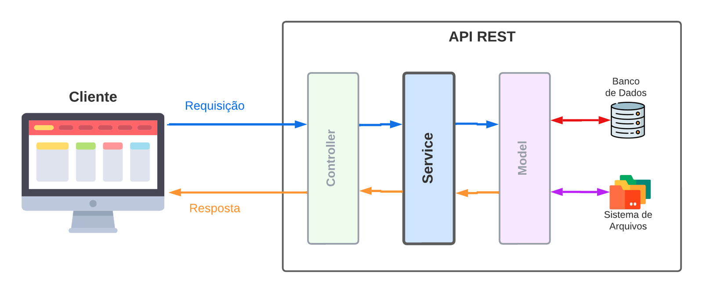

# 6.8 - Camada Service e as Regras de Negócio

> Seção 6 - Design Modular com Arquitetura em Camadas · Lição 8 de 19

Agora que você já explorou as camadas de **Model** e **Controller** na construção da nossa arquitetura de software, vamos dar um passo adiante e entender a camada Service. Esta camada é responsável pela aplicação das **regras de negócio**, as diretrizes que definem como o sistema deve se comportar em determinadas situações.

A camada Service ocupa uma posição central no fluxo de dados da arquitetura, e a organização de cada camada permite uma comunicação fluida e bem estruturada, com o **Service** cuidando especificamente da lógica de negócios. A imagem abaixo ilustra a disposição das camadas, destacando a Service como o núcleo de aplicação das regras que agregam valor ao sistema:

 Visão geral da Arquitetura em camadas.

## Limites e Responsabilidades da Camada Service

A camada Service é focada em **regras de negócio**, que representam as validações e lógicas que o sistema deve seguir para cumprir suas funções. O isolamento das regras de negócio na camada Service ajuda a preservar a clareza e a independência do sistema, minimizando o acoplamento com as tecnologias específicas usadas nas camadas Model e Controller. Esse isolamento possibilita a **facilidade de manutenção** e a **adaptabilidade** ao longo do tempo, evitando que as lógicas de negócio fiquem dependentes de frameworks, bancos de dados ou interfaces externas.

**Exemplo**: Em um sistema bancário, a camada Service gerenciaria a lógica de cálculo de juros para um empréstimo, sem precisar saber como os dados são persistidos na camada Model ou como são apresentados na camada Controller.

## O que são Regras de Negócio?

A expressão **regras de negócio** refere-se às diretrizes que determinam como o sistema deve operar para entregar o valor desejado. As regras de negócio podem ser de dois tipos principais:

-   **Validações de entrada**: verificações de integridade e formato dos dados, como "o nome do produto deve ter no mínimo cinco letras" ou "o CPF não pode conter letras".
-   **Regras de negócio complexas**: restrições que vão além da validação de dados, como "apenas produtos em estoque podem ser vendidos" ou "compras abaixo de R$ 100,00 não podem ser parceladas em mais de cinco vezes".

> **Anota aí 🖊**: O levantamento e a definição das regras de negócio são realizados junto ao `cliente` ou aos `stakeholders` da aplicação. Cada uma dessas regras deve ser documentada e mantida de forma isolada de detalhes técnicos.

### Aplicando Regras de Negócio no Sistema de Gestão Escolar

Como exemplo, na API do sistema escolar que estamos desenvolvendo, as regras de negócio podem incluir:

-   **Verificação de pré-requisitos de disciplina antes da matrícula**, garantindo que o aluno concluiu com sucesso disciplinas obrigatórias antes de se matricular em outras avançadas.
-   **Controle de matrícula em disciplinas**, garantindo que o número de vagas não exceda a capacidade máxima de uma turma.
-   **Regra de atualização de status de aluno**, como aprovação ou reprovação automática com base nas notas.

A camada Service, portanto, centraliza essas decisões de lógica e validações específicas, deixando a camada Model focada no acesso ao banco de dados e a Controller dedicada ao fluxo das requisições e respostas HTTP.

## Atributos Essenciais da Camada Service

A camada Service, para desempenhar bem suas funções, deve:

-   **Conter as regras de negócio do sistema**, centralizando a lógica principal e qualquer validação complexa que não seja apenas sobre a entrada dos dados.
-   **Exemplo**: No sistema escolar, verificar se um estudante pode ser aprovado com base em suas notas, presença ou pendências financeiras.
-   **Abstrair regras de negócio do modelo de dados**, garantindo que mudanças na estrutura de dados (Model) ou na interface HTTP (Controller) não impactem diretamente a lógica de negócios.
-   **Exemplo**: Determinar se um estudante está qualificado para uma bolsa de estudos com base em suas notas e frequência escolar ao longo do ano letivo.

### O que a Camada Service Não Deve Fazer

-   **Não deve incluir acessos diretos ao banco de dados**, ou seja, não deve conter `queries` SQL ou dependências da camada Model.
-   **Exemplo**: A Service não deve buscar um aluno diretamente na tabela, mas pode, sim, solicitar ao Model a busca, aplicando lógica extra, como formatação ou regras de visibilidade.
-   **Não deve lidar com HTTP**: request e response são gerenciados pela camada Controller, que organiza o que é passado à camada Service.
-   **Exemplo**: A Service pode processar a lógica de envio de uma notificação, mas a formatação da resposta HTTP é responsabilidade da Controller.

> **De olho na dica 👀:** Ao centralizar as regras de negócio e isolar a lógica na Service, conseguimos uma estrutura mais organizada, que facilita a manutenção e permite que as camadas Model e Controller se foquem exclusivamente em suas funções.

OBS da IA

**Para o SAP CAP**

-   Regras de negócio no CAP ficam em handlers de serviço: `this.before('CREATE', 'Enrollments', async (req) => { ... req.reject(409, 'SUBJECT_FULL') })`. A lógica é a mesma ensinada aqui, só muda o "encaixe".

