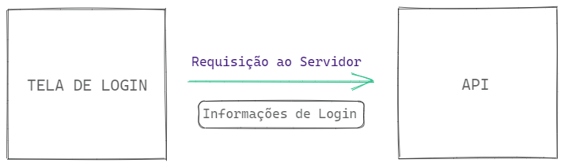
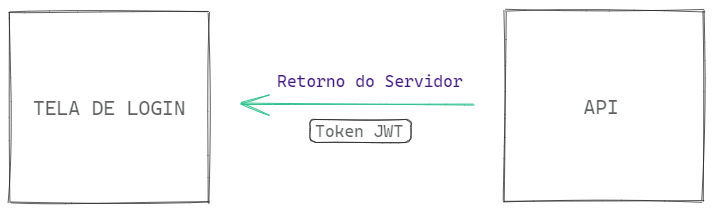
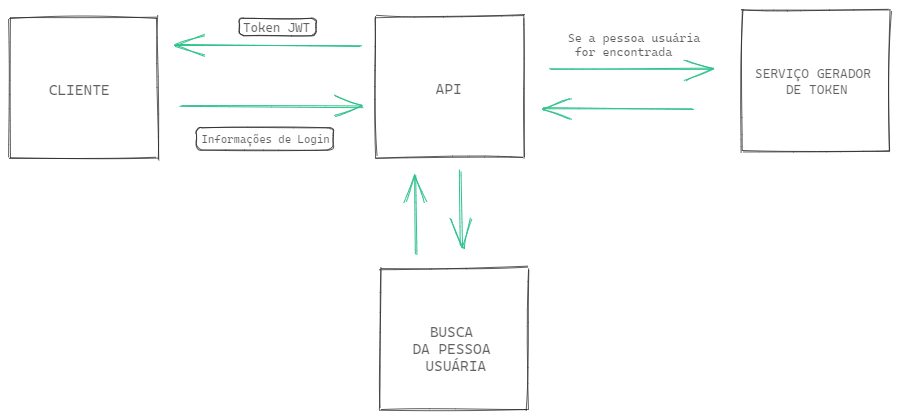

# 7.5 - Autenticação

> Seção 7 - Controle de Acesso e Autenticação · Lição 5 de 12

**Autenticar** é um verbo comum no universo do desenvolvimento de software e possui um propósito bem definido. Refletindo sobre o significado da palavra, autenticação é a **validação de que algo é autêntico**, ou seja, a confirmação da veracidade de determinado requisito.

No mundo do desenvolvimento de sistemas, o conceito é o mesmo. A autenticação garante que, por exemplo, uma pessoa usuária de um software demonstre sua identidade, confirmando que pode acessar determinados recursos ou informações.

Esse processo está diretamente ligado à **segurança da informação**, já que um dos objetivos é reduzir os riscos de acesso indevido ou vazamento de dados de uma aplicação. Um exemplo prático é o processo de `login`, em que a pessoa usuária é identificada antes de acessar o sistema.

Um dos métodos mais utilizados para autenticação é o **JSON Web Token (JWT)**, que funciona como um token de comunicação entre duas partes de um sistema. Ele permite que as informações de autenticação sejam transmitidas com segurança em formato JSON.

## Passo a passo do funcionamento da autenticação com o JWT

Vamos entender o processo de autenticação utilizando o JWT através de um exemplo simples: um sistema de *streaming* em que o login é necessário para acessar conteúdos exclusivos.

### 1\. O envio de credenciais

Quando a pessoa usuária preenche o formulário de login com seu e-mail e senha e clica no botão para acessar o sistema, uma requisição HTTP é enviada para o servidor. Essa requisição ativa um `endpoint` da API responsável por autenticar o usuário.



### 2\. A geração do token JWT

No servidor, a API verifica as credenciais da pessoa usuária. Se estiverem corretas, a autenticação é realizada com sucesso e um token JWT é gerado. Esse token será devolvido para o cliente, permitindo que ações futuras sejam realizadas com base nessa autenticação.



### 3\. Uso do token nas requisições subsequentes

Com o token JWT em mãos, o cliente pode enviá-lo no header de novas requisições HTTP para acessar funcionalidades restritas da aplicação, como comentar em vídeos ou salvar favoritos. O servidor valida o token recebido antes de executar as operações solicitadas.

## Instalação do JWT no Node.js

Para trabalhar com `JWT` em aplicações `Node.js`, é necessário instalar a biblioteca `jsonwebtoken`. Para isso, execute o seguinte comando no terminal:

```bash
npm install -E jsonwebtoken@9.0.2
```

Com isso, você estará pronto para implementar autenticação com JWT em seu projeto.

<details>
<summary>OBS da IA</summary>

**Alternativa mais moderna**

-   `jsonwebtoken` ainda é muito usado; a alternativa moderna é **`jose`** (sem dependências, ESM, Web Crypto, funciona em Node/Deno/edge).
-   Ao verificar, fixe o algoritmo: `jwt.verify(token, secret, { algorithms: ['HS256'] })`.

**Atenção**

-   `process.env.JWT_SECRET || 'secret'`: se a variável faltar, a API assina tokens com um segredo público. Em produção, aborte a inicialização quando o segredo não estiver definido.

</details>

## Geração de Token

Voltando à nossa API Cookmaster, vamos implementar a geração de token JWT. Assumindo que a API já possui a funcionalidade de login implementada, ajustaremos o código para que ele retorne um token JWT sempre que o login for bem-sucedido.



### 1\. Criando a função de geração de tokens

Criaremos um arquivo chamado `src/utils/manager.JWT.js` para centralizar a lógica de geração de tokens:

```javascript
// src/utils/manager.JWT.js

const jwt = require('jsonwebtoken');

const JWT_SECRET = process.env.JWT_SECRET || 'secret';

const jwtConfig = {
  expiresIn: '1d', // O token expira em 1 dia
  algorithm: 'HS256', // Algoritmo de assinatura
};

const createToken = (payload) => {
  const token = jwt.sign(payload, JWT_SECRET, jwtConfig);
  return token;
};

module.exports = {
  createToken,
};
```

#### Explicação do código

1.  `JWT_SECRET`: Define uma chave secreta para assinar o token. Essa chave é fundamental para garantir que o token seja validado corretamente.
2.  `jwtConfig`: Configurações do token, como o tempo de expiração (`expiresIn`) e o algoritmo de assinatura (`HS256`).
3.  `createToken`: Recebe os dados da pessoa usuária (como id e e-mail) e gera um token JWT assinado.

### 2\. Modificando o Service

No arquivo `src/service/user.service.js`, faremos alterações para que o serviço de login e cadastro retorne o token JWT:

```javascript
// src/service/user.service.js

// const bcrypt = require('bcryptjs');

// const userModel = require('../model/user.model');
const { createToken } = require('../utils/manager.JWT');

// Outras Implementações

// const createUser = async (user) => {
//   const salt = bcrypt.genSaltSync(10);
//   const hashedPassword = bcrypt.hashSync(user.password, salt);

//   const newUserWithBcrypt = { ...user, password: hashedPassword };
//   const newUser = await userModel.create(newUserWithBcrypt);

  const { password: _, ...userWithoutPassword } = newUser;
  const token = createToken(userWithoutPassword);

  return token;
// };

// Outras Implementações

// const findUserByEmail = async ({ email, password }) => {
//   const user = await userModel.findByEmail(email);

//   if (!user) return { error: 'Invalid fields' };

//   const isPasswordValid = bcrypt.compareSync(password, user.password);

//   if (!isPasswordValid) return { error: 'Invalid fields' };

  const { id, name, role } = user;
  const token = createToken({ id, name, email, role });

  return token;
// };

// Outras Implementações
```

Em ambas as funções, `createUser` e `findUserByEmail`, o token é gerado a partir dos dados da pessoa usuária (exceto a senha) e retornado como resposta da função.

### 3\. Modificando o Controller

No arquivo `src/controller/user.controller.js`, ajustamos o método de cadastro para retornar o token:

```javascript
// src/controller/user.controller.js

// Outras Implementações

// const createUser = async (req, res) => {
  const user = req.body;
  const token = await userService.createUser(user);

  return res.status(201).json({ token });
// };

// Outras Implementações
```

e também o arquivo de `src/controller/auth.controller.js` para que ele consiga retornar o token

```javascript
// src/controller/auth.controller.js

// const login = async (req, res) => {
//   const { email, password } = req.body;
  const token = await userService.findUserByEmail({ email, password });

  if (token.error) {
    return res.status(400).json({ error: token.error });
  }

  return res.status(201).json({ token });
// };
```

Com essas alterações, ao realizar o **login** ou o **cadastro**, um token JWT será gerado e retornado para o cliente, permitindo acesso a recursos restritos.

## Autenticação com JWT

Além de gerar tokens JWT para autenticar usuários, precisamos garantir que o sistema valide esses tokens em cada requisição protegida. Essa validação assegura que apenas usuários autenticados possam acessar determinadas rotas ou recursos.

A melhor forma de implementar essa validação é utilizando um middleware, que intercepta as requisições protegidas e verifica se o token fornecido é válido. Se for, a requisição continua; caso contrário, ela é bloqueada.

### 1\. Criando a função de verificação de token

Vamos adicionar a lógica de validação de tokens no arquivo `src/utils/manager.JWT.js`, centralizando todas as operações relacionadas ao JWT:

```javascript
// src/utils/manager.JWT.js

// const jwt = require('jsonwebtoken');

// const JWT_SECRET = process.env.JWT_SECRET || 'secret';

// const jwtConfig = {
//   expiresIn: '1d',
//   algorithm: 'HS256',
// };

// const createToken = (payload) => {
//   const token = jwt.sign(payload, JWT_SECRET, jwtConfig);
//   return token;
// };

const verifyToken = (token) => {
  try {
    const decoded = jwt.verify(token, JWT_SECRET);
    return decoded;
  } catch (error) {
    return null; // Retorna null caso o token seja inválido ou expirado
  }
};

// module.exports = {
//   createToken,
  verifyToken,
// };
```

#### Explicação do código

`verifyToken`: Recebe um token JWT e verifica sua validade. - Utiliza a função `jwt.verify` para verificar a validade do token. - Retorna os dados decodificados caso o token seja válido. - Caso o token seja inválido, será gerado um erro e a função retornará `null`.

### 2\. Criando o middleware de autenticação

Agora, criaremos um middleware que utiliza a função `verifyToken` para autenticar as requisições protegidas. Vamos adicioná-lo em um arquivo chamado `src/middleware/auth.middleware.js`:

```javascript
// src/middleware/auth.middleware.js

const { verifyToken } = require('../utils/manager.JWT');

const authenticateToken = (req, res, next) => {
  const bearerToken = req.headers.authorization; // Token deve ser enviado no cabeçalho da requisição no formato bearer

  if (!token) return res.status(401).json({ error: 'Token Not Found!' });

  const token = bearerToken.split(' ')[1];

  if (!token) return res.status(401).json({ error: 'Token Not Found!' });

  const decoded = verifyToken(token);

  if (!decoded) {
    return res.status(401).json({ error: 'Invalid or expired token' });
  }

  req.user = decoded; // Adiciona os dados do usuário decodificados no objeto req
  return next();
};

module.exports = authenticateToken;
```

#### Explicação do código

1.  O middleware busca o token no cabeçalho `Authorization`.
2.  Caso o token não seja encontrado, retorna uma resposta `401 - Unauthorized`.
3.  Se o token for inválido ou expirado, retorna uma resposta com mensagem de erro.
4.  Caso seja válido, adiciona os dados do usuário no objeto `req` e permite que a requisição continue.

<details>
<summary>OBS da IA</summary>

**Atenção**

-   No middleware mostrado, a linha `if (!token)` aparece **antes** de `const token = ...` — isso gera `ReferenceError`. A primeira verificação deveria ser `if (!bearerToken)`.

**Para o SAP CAP**

-   No CAP não há middleware de JWT manual. Declare no CDS: `@requires: 'authenticated-user'` no serviço/entidade. Em desenvolvimento use `cds.requires.auth.kind: 'mocked'` (usuários de teste no `package.json`); em produção `xsuaa` ou `ias`. O usuário logado fica em `req.user` (`req.user.id`, `req.user.is('admin')`).

</details>

### 3\. Protegendo rotas com o middleware

Para usar o middleware, basta aplicá-lo nas rotas que exigem autenticação. Vamos proteger uma rota de exemplo no arquivo `src/routes/recipes.routes.js`:

```javascript
// src/routes/recipes.routes.js

// const express = require('express');

// const recipeController = require('../controller/recipe.controller');
// const validateRecipe = require('../middlewares/validate.recipe');
const authenticateToken = require('../middlewares/auth.middleware');

// const router = express.Router();

// router.get('/', recipeController.findAllRecipes);
// router.get('/:id', recipeController.findRecipeById);

router.post('/',
  authenticateToken,
  validateRecipe.validateCreateRecipe,
  recipeController.createRecipe);

router.put('/:id',
  authenticateToken,
  validateRecipe.validateUpdateRecipe,
  recipeController.updateRecipe);

router.delete('/:id', authenticateToken, recipeController.deleteRecipe);

// module.exports = router;
```

#### Explicação das alterações:

-   As rotas que utilizam os métodos POST, PUT e DELETE exigem autenticação e utilizam o middleware authenticateToken para validar o token antes de acessar o controlador.
-   Já as rotas `GET` permanecem públicas, não exigindo autenticação.

Com essas modificações, a API agora está equipada para autenticar usuários com JWT, proteger rotas de `recipes` e validar tokens. Esse fluxo completo garante segurança e praticidade para as requisições autenticadas!

Agora, vamos fixar os conceitos aprendidos com o vídeo a seguir:
