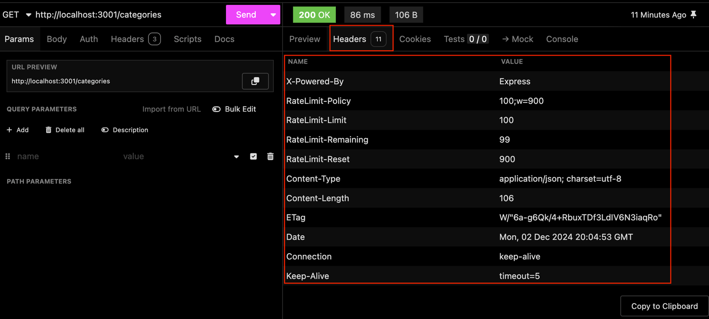
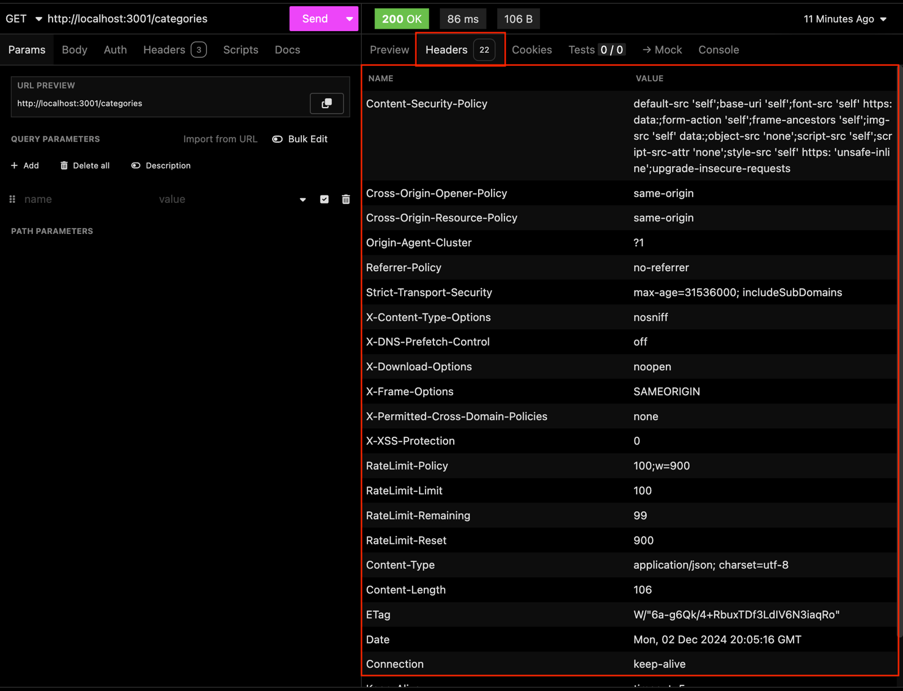

# 8.4 - Proteção de Cabeçalho com Helmet

> Seção 8 - Protegendo APIs: Segurança em Node.js · Lição 4 de 12

A proteção de cabeçalhos HTTP é uma das práticas essenciais para fortalecer a segurança de aplicações web. O [Helmet](https://www.npmjs.com/package/helmet) é uma biblioteca que ajuda a proteger sua aplicação contra vulnerabilidades comuns configurando os cabeçalhos HTTP adequadamente.

## O que é o Helmet?

O **Helmet** é um conjunto de middlewares que ajusta os cabeçalhos HTTP de uma aplicação Express, adicionando proteções contra ataques e exposição de informações sensíveis.

Sem o Helmet, sua aplicação pode estar vulnerável a ataques que exploram configurações padrão ou cabeçalhos mal configurados.

## Principais Benefícios

1.  **Mitigar vulnerabilidades comuns**: Configurações padrão de cabeçalhos HTTP podem deixar a aplicação exposta a ataques conhecidos.  
    
2.  **Facilidade de uso**: O Helmet fornece uma configuração pronta, mas permite ajustes personalizados conforme necessário.  
    
3.  **Boas práticas de segurança**: Simplifica a adoção de padrões recomendados, como [OWASP](https://owasp.org/about/) e segurança em navegadores.  
    

## Proteções padrão do Helmet

Por padrão, o Helmet habilita uma série de proteções importantes, dentre elas:

-   **Content-Security-Policy (CSP)**: Ajuda a prevenir ataques de [Cross-Site Scripting](https://developer.mozilla.org/en-US/docs/Glossary/Cross-site_scripting) (XSS) e outros tipos de ataques de injeção de conteúdo.  
    
-   **Cross-Origin-Resource-Policy (CORP)**: Restringe quais origens podem acessar recursos compartilhados.  
    
-   **Strict-Transport-Security (HSTS)**: Força o uso de conexões HTTPS, protegendo contra ataques do tipo [Manipulator-in-the-Middle (MitM)](https://developer.mozilla.org/en-US/docs/Glossary/MitM).  
    
-   **X-Content-Type-Options**: Previne que navegadores interpretem arquivos como HTML, evitando ataques de [MIME-sniffing](https://developer.mozilla.org/pt-BR/docs/Web/HTTP/MIME_types).  
    

## Adicionando o Helmet à sua Aplicação Cookmaster

Primeiro, instale o Helmet na sua aplicação com o seguinte comando:

```bash
npm install -E helmet@8.0.0
```

No arquivo `src/app.js`, basta importar o Helmet e usá-lo como middleware global:

```javascript
// src/app.js

// const express = require('express');
const helmet = require('helmet');
// require('express-async-errors');

// Outras Importações

// const app = express();

app.use(helmet());
// app.use(express.json());
// app.use(rateLimiter);
// app.use(speedLimiter);

// Outras Configurações e Rotas
```

Com apenas essa linha `app.use(helmet())`, sua aplicação já estará protegida por padrão com todas as proteções oferecidas pelo Helmet.

<details>
<summary>OBS da IA</summary>

**Alternativa mais moderna**

-   Helmet 8 é a versão atual. O `require('express-async-errors')` que aparece no código é dispensável no **Express 5**, que já trata erros de handlers `async` (veja a OBS da lição 3.14), e o pacote está sem manutenção.

**Para o SAP CAP**

-   No CAP o Helmet entra via `cds.on('bootstrap', (app) => app.use(helmet()))`. Em apps Fiori no BTP, cabeçalhos como CSP costumam ser definidos no approuter.

</details>

## Teste: Antes e depois do Helmet

### Teste sem o Helmet

Faça uma requisição para qualquer rota da sua aplicação, por exemplo, `GET /categories`, usando o **Insomnia**. Você verá que os cabeçalhos padrão da resposta (`Headers`) estarão parecidos com a imagem abaixo:



**O que analisar**:

-   **Cabeçalho `X-Powered-By`**: Este cabeçalho expõe que sua aplicação utiliza Express. Embora pareça inofensivo, ele revela a tecnologia usada no back-end, o que pode facilitar ataques direcionados contra vulnerabilidades específicas do Express.

### Teste com o Helmet

Agora, habilite o Helmet conforme mostrado anteriormente e refaça a mesma requisição:



**O que mudou**:

-   **Cabeçalhos adicionados**: Várias camadas de proteção foram habilitadas automaticamente.
-   **X-Powered-By removido**: Menos informações sobre sua tecnologia estão expostas.

Esses novos cabeçalhos fortalecem a segurança e reduzem vulnerabilidades.

## Personalizando o Helmet

O Helmet também permite configurações específicas para atender às necessidades do projeto.

Por exemplo, para habilitar a proteção contra ataques de Cross-Site Scripting, você pode configurar o `Content-Security-Policy`:

```javascript
app.use(helmet({
  contentSecurityPolicy: {
    directives: {
      defaultSrc: ["'self'"],
      scriptSrc: ["'self'", 'code.example.com'],
    },
  },
}));
```

### Explicação das Configurações:

1.  `defaultSrc`: Define a origem padrão para todos os recursos não especificados, como imagens, estilos e scripts. No exemplo, estamos permitindo que todos os recursos sejam carregados apenas da mesma origem (`'self'`).  
    
2.  `scriptSrc`: Restringe os scripts que podem ser carregados, permitindo apenas os que vêm da mesma origem (`'self'`) ou de um domínio confiável especificado (`code.example.com`).  
    

Essas configurações são úteis para reforçar ainda mais a segurança, controlando exatamente o que pode ser carregado e de onde.

Com o **Helmet** implementado, sua aplicação estará protegida contra uma ampla gama de vulnerabilidades comuns, de maneira eficiente e fácil de gerenciar. Além disso, sua configuração personalizada permite atender a requisitos específicos de segurança, alinhando a aplicação às melhores práticas recomendadas.
