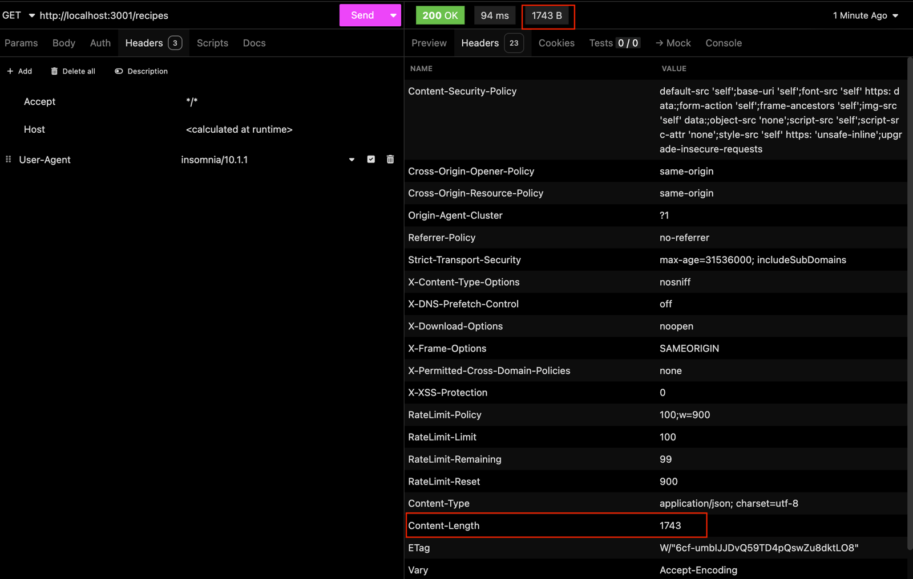
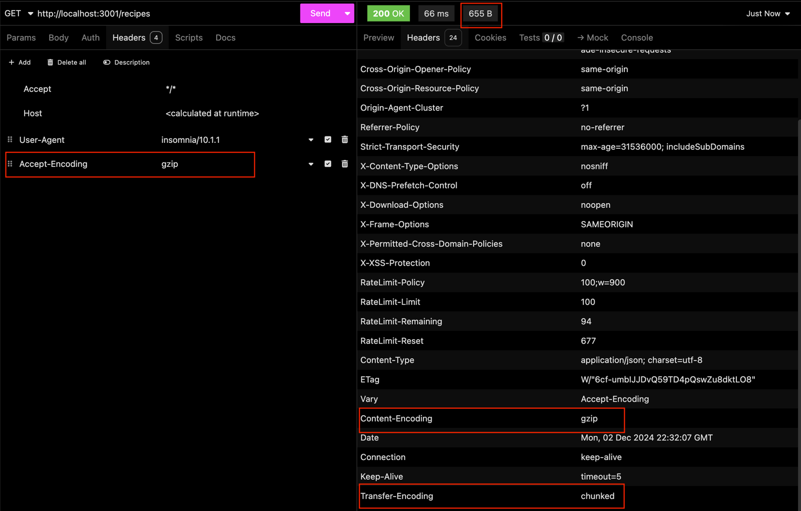

# 8.5 - Compression: Compressão de Respostas HTTP

> Seção 8 - Protegendo APIs: Segurança em Node.js · Lição 5 de 12

Reduzir o tamanho das respostas HTTP é uma prática importante para melhorar o desempenho de aplicações web. O middleware [compression](https://www.npmjs.com/package/compression) facilita esse processo, aplicando compressão Gzip ou Brotli às respostas do servidor, resultando em transferências de dados mais rápidas e uma melhor experiência para o usuário final.

## O que é o Compression?

O **Compression** é um middleware para aplicações Express que compacta automaticamente as respostas enviadas pelo servidor. Ao reduzir o tamanho das respostas HTTP, ele diminui a quantidade de dados transmitidos pela rede, acelerando o carregamento de páginas e economizando largura de banda.

## Principais Benefícios

1.  **Redução de uso de largura de banda**: Diminui significativamente o tamanho dos arquivos transferidos para o cliente.  
    
2.  **Melhoria de desempenho**: Respostas menores são transferidas mais rapidamente, proporcionando carregamento mais rápido.  
    
3.  **Configuração simples**: O Compression é fácil de integrar e personalizar conforme as necessidades da aplicação.  
    

## Como funciona a compressão?

A compressão funciona ao aplicar algoritmos como Gzip ou Brotli às respostas HTTP. Esses algoritmos analisam o conteúdo, identificam redundâncias e compactam os dados para transmitir um arquivo menor ao cliente. Navegadores modernos conseguem descompactar as respostas automaticamente antes de exibi-las.

**Sem compressão**:

-   Resposta em texto simples: 200 KB.
-   Tempo de transferência: 400 ms.

**Com compressão**:

-   Resposta comprimida: 50 KB.
-   Tempo de transferência: 100 ms.

## Adicionando o Compression à sua Aplicação Cookmaster

Primeiro, instale o Compression na sua aplicação com o seguinte comando:

```bash
npm install -E compression@1.7.5
```

No arquivo `src/app.js`, importe e configure o compression como global:

```javascript
// src/app.js

// const express = require('express');
// const helmet = require('helmet');
const compression = require('compression');
// require('express-async-errors');

// Outras Importações

// const app = express();

app.use(compression());

// Outras Configurações e Rotas
```

Com essa configuração, todas as respostas da sua aplicação serão compactadas automaticamente.

## Teste: Antes e depois do Compression

### Teste sem compressão

Faça uma requisição para qualquer rota da sua aplicação, por exemplo, `GET /recipes`, usando o **Insomnia**. Você verá que os cabeçalhos da resposta estarão parecidos com a imagem abaixo:



**O que analisar**:

-   **Content-Length**: Indica o tamanho da resposta em bytes. Nesse caso, a resposta ocupa 1743 bytes.

### Teste com compressão

Agora, para vermos o compression em ação, é preciso enviar na requisição o cabeçalho com a opção `Accept-Encoding: gzip`, igual na imagem abaixo:



**O que analisar**:

-   **Content-Encoding**: Indica que a resposta foi compactada com **Gzip**.
-   **Content-Length**: O tamanho da resposta agora é menor, reduzido para 655 bytes.

Com isso, você consegue verificar a eficácia do Compression diretamente na redução de tamanho das respostas.

## Personalizando o Compression

Embora o Compression funcione bem com a configuração padrão, ele permite ajustes para atender às necessidades específicas da aplicação. Vamos para um exemplo de personalização:

```javascript
// src/app.js

app.use(
  compression({
    level: 6, // Nível de compressão (0 a 9)
    threshold: 1024,
  })
);
```

### Explicação das Configurações:

1.  **level**: Define o nível de compressão. Valores mais altos proporcionam maior compressão, mas consomem mais CPU. O padrão é 6.  
    
2.  **threshold**: Estabelece o tamanho mínimo da resposta para ativar a compressão. No exemplo, somente respostas maiores que 1 KB serão compactadas.  
    

## Quando não usar Compression?

Embora a compressão seja geralmente vantajosa, existem cenários onde ela não é recomendada:

-   **Respostas pequenas**: A compressão pode aumentar o tempo de processamento para respostas muito pequenas.
-   **CPU limitada**: Em servidores com pouca capacidade de processamento, a compressão pode consumir muitos recursos, prejudicando o desempenho geral.
-   **Conteúdo já comprimido**: Arquivos como imagens ou vídeos geralmente já estão compactados, e tentar comprimi-los novamente é desnecessário.

<details>
<summary>OBS da IA</summary>

**Alternativa mais moderna**

-   Em produção a compressão geralmente fica no proxy/CDN (nginx, load balancer), que também oferece **Brotli**, mais eficiente que gzip.

**Para o SAP CAP**

-   No BTP o **approuter** tem configuração de compressão (`compression` no `xs-app.json`).

</details>
