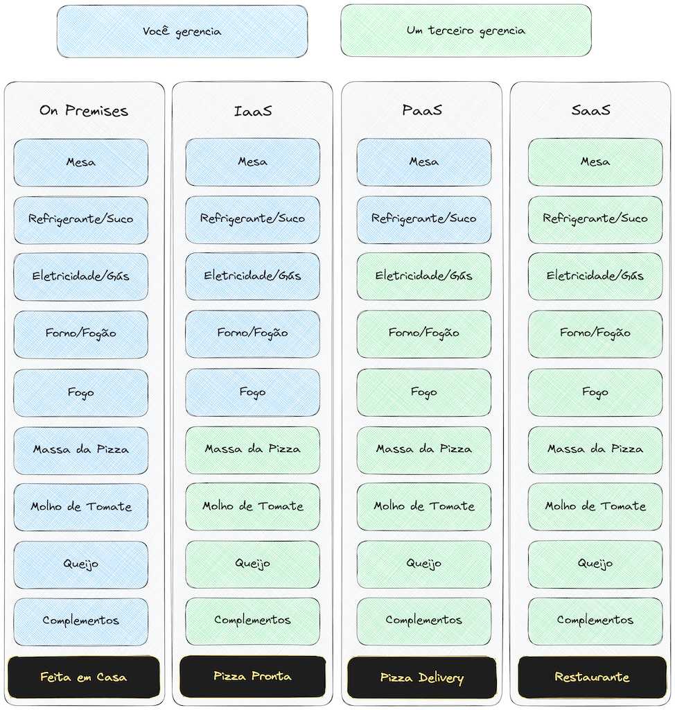
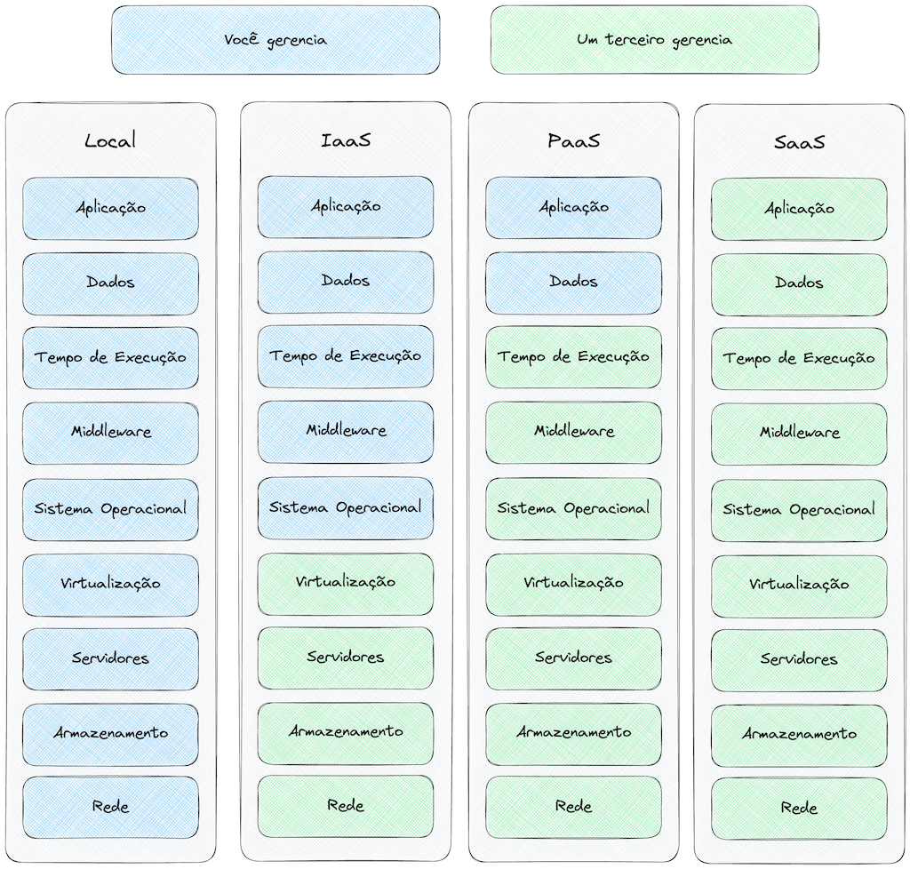

# 9.3 - Computação em Nuvem

> Seção 9 - Automatização e Deploy de Aplicações · Lição 3 de 11

**Computação em nuvem** refere-se ao uso de serviços executados em servidores remotos, em vez de locais. Em vez de instalar tudo no seu computador, você utiliza recursos hospedados em servidores ao redor do mundo.

## Principais serviços de computação em nuvem:

-   **IaaS (Infraestrutura como Serviço)**: fornece infraestrutura como máquinas virtuais, armazenamento e redes.
-   **Exemplos**: AWS, Google Compute Engine, Oracle Cloud.
-   **PaaS (Plataforma como Serviço)**: oferece uma plataforma para desenvolver, hospedar e gerenciar aplicações sem se preocupar com infraestrutura.
-   **Exemplos**: Railway, Heroku, Google App Engine.
-   **SaaS (Software como Serviço)**: disponibiliza softwares prontos para uso via navegador ou aplicativo.
-   **Exemplos**: Google Docs, Microsoft 365, Dropbox.

Agora na imagem abaixo temos um exemplo lúdico de como esses serviços funcionam pensando em como seria comer uma pizza e a infraestrutura necessária para isso:

Compare com esse quadro que presenta de uma forma mais realista:

## Por que usar Computação em Nuvem?

1.  **Redução de Custos**: Com a computação em nuvem, as empresas não precisam mais investir em infraestrutura própria. Você paga apenas pelo que utiliza, reduzindo custos com hardware, energia e manutenção.
2.  **Escalabilidade**: É possível aumentar ou diminuir recursos conforme necessário. Por exemplo, se sua aplicação precisa de mais memória em um período específico, você pode adquirir temporariamente apenas a quantidade adicional necessária.
3.  **Facilidade de Acesso**: Os serviços são acessíveis de qualquer lugar, permitindo que equipes em diferentes localidades colaborem facilmente.

## Entendendo na prática

Para ilustrar, pense que você quer "hospedar sua aplicação". Ao invés de comprar servidores e configurar tudo do zero, você pode "alugar um espaço" em servidores como os da Amazon ou Google.

Dependendo do tipo de serviço que você escolher (IaaS, PaaS ou SaaS), terá diferentes níveis de controle e responsabilidades. Por exemplo:

-   Com **IaaS**, você controla praticamente tudo, como se estivesse configurando seu próprio servidor.
-   Com **PaaS**, você só se preocupa com o código da aplicação; a infraestrutura é gerenciada para você.
-   Com **SaaS**, tudo já está pronto — basta usar.

Se quiser se aprofundar, veja este artigo da [Red Hat sobre IaaS, PaaS e SaaS](https://www.redhat.com/pt-br/topics/cloud-computing/iaas-vs-paas-vs-saas).

OBS da IA

**Para o SAP CAP**

-   O **SAP BTP** é a PaaS onde apps CAP costumam rodar, com dois runtimes principais: **Cloud Foundry** e **Kyma** (Kubernetes).

