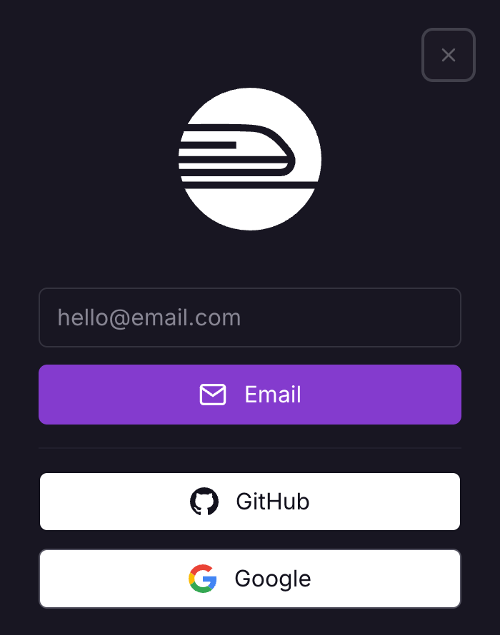
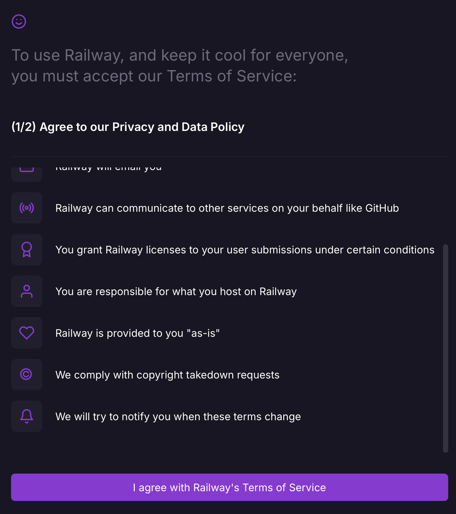
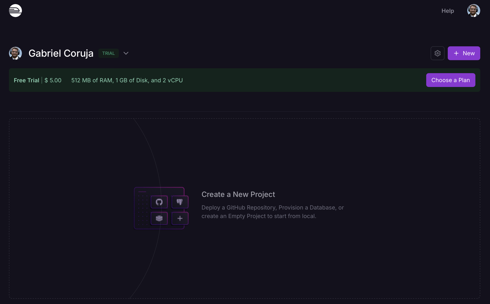

# 9.5 - Railway

> Seção 9 - Automatização e Deploy de Aplicações · Lição 5 de 11

O [Railway](https://railway.app/) é uma plataforma de infraestrutura como serviço (IaaS) que permite aos desenvolvedores provisionar recursos, desenvolver aplicações localmente utilizando essa infraestrutura e, posteriormente, implantá-las na nuvem. Com o Railway, é possível hospedar tanto aplicações front-end quanto back-end, além de bancos de dados, de forma simplificada.

## Criando uma Conta no Railway

Para começar a utilizar os recursos do Railway, é necessário criar uma conta na plataforma. O Railway oferece uma camada gratuita que permite testar seus serviços sem a necessidade de fornecer informações de pagamento, desde que você possua uma conta no GitHub.

**Observações Importantes:**

-   **Contas Recentes no GitHub**: Se sua conta no GitHub foi criada recentemente, o Railway pode solicitar informações adicionais para verificar sua identidade, como a adição de um cartão de crédito. Isso é uma medida de segurança para evitar múltiplas contas gratuitas por um único usuário. No entanto, você só será cobrado se optar por fazer um upgrade para um plano pago.
-   **Política de Uso Justo**: O Railway possui uma Política de Uso Justo que proíbe a hospedagem de determinados tipos de conteúdo. Certifique-se de que sua aplicação está em conformidade com essas políticas para evitar penalidades ou banimento.

### Passo a Passo para Criar uma Conta:

1.  Acesse o Site do Railway:
2.  Visite o [site oficial do Railway](https://railway.app/).
3.  Inicie o Processo de Login:
4.  No canto superior direito da página inicial, clique em "Login".
5.  Escolha o Método de Autenticação:
6.  Uma janela pop-up será exibida com opções de login via e-mail ou GitHub.
7.  Recomenda-se selecionar a opção `GitHub` para facilitar a integração futura.

Pop-up de Login do `Railway`

1.  Autentique-se no GitHub:
2.  Se ainda não estiver logado no GitHub, você será redirecionado para a página de login do GitHub.
3.  Insira suas credenciais do GitHub e autorize o Railway a acessar suas informações básicas.
4.  Aceite os Termos de Serviço:
5.  Após a autenticação, o Railway solicitará que você aceite os Termos de Serviço e a Política de Uso Justo.
6.  Leia atentamente os termos apresentados e, se concordar, clique em "I agree with Railway's Terms of Service".
7.  Em seguida, confirme que não implantará conteúdos proibidos clicando em "I will not deploy any of that".

Termos de Serviço do `Railway`

Seguindo esses passos, você terá acesso aos recursos gratuitos do Railway, e verá a tela inicial da plataforma, onde poderá criar novos projetos e gerenciar suas aplicações igual na imagem abaixo:

Dashboard Inical do `Railway`
