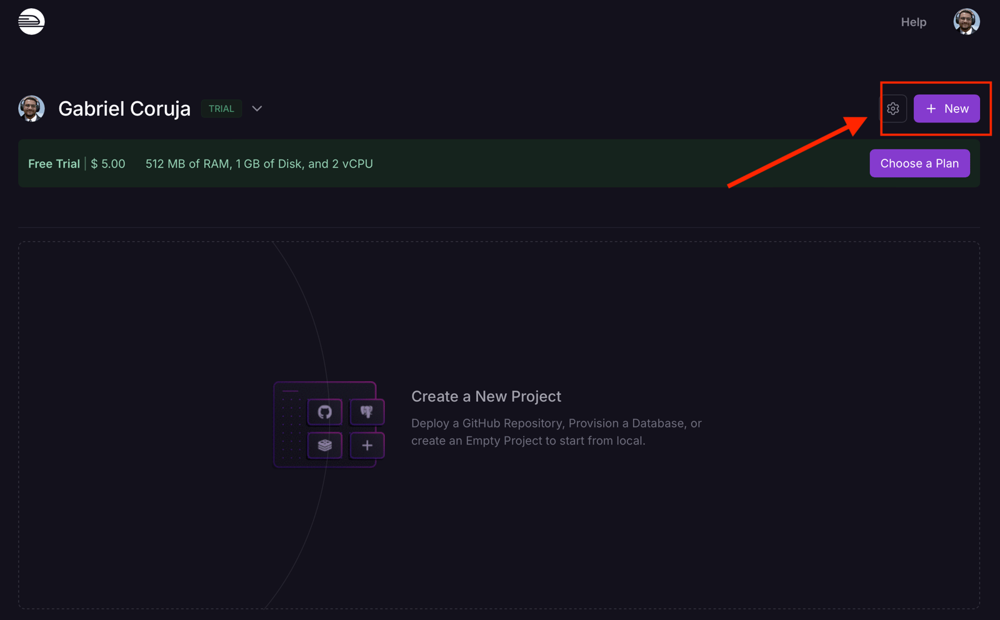
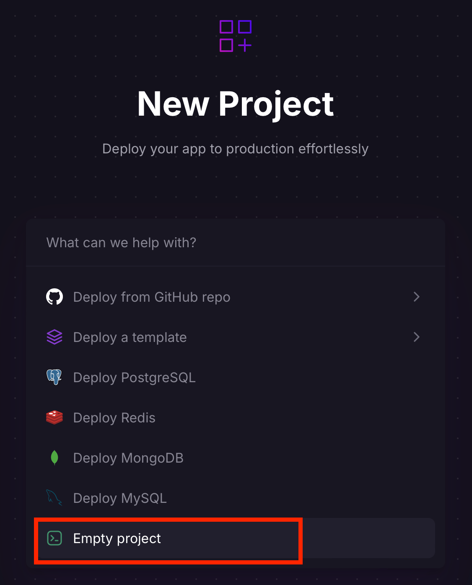
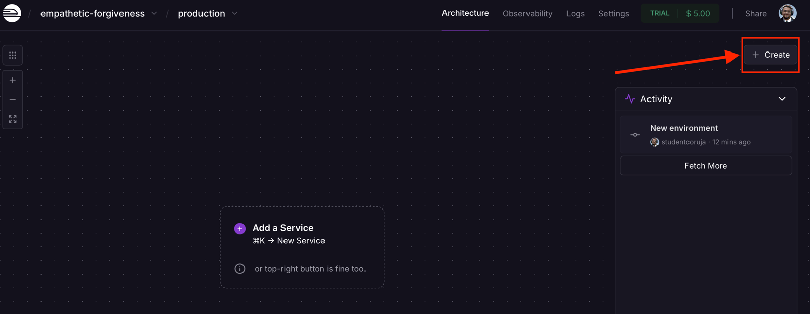
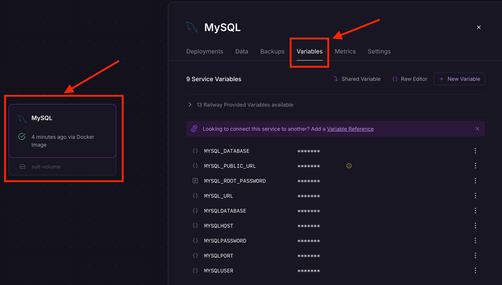
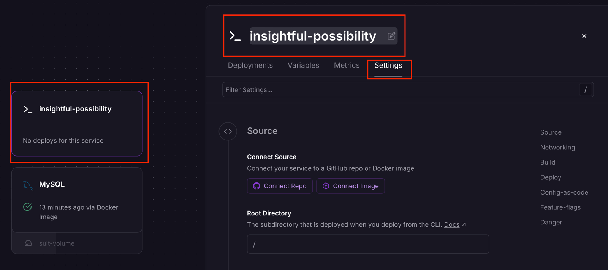
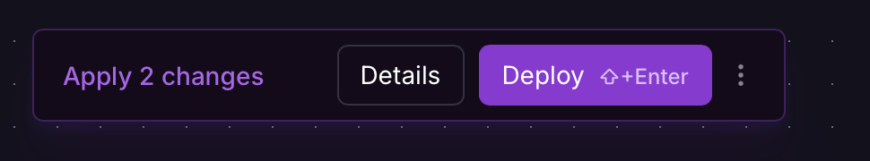
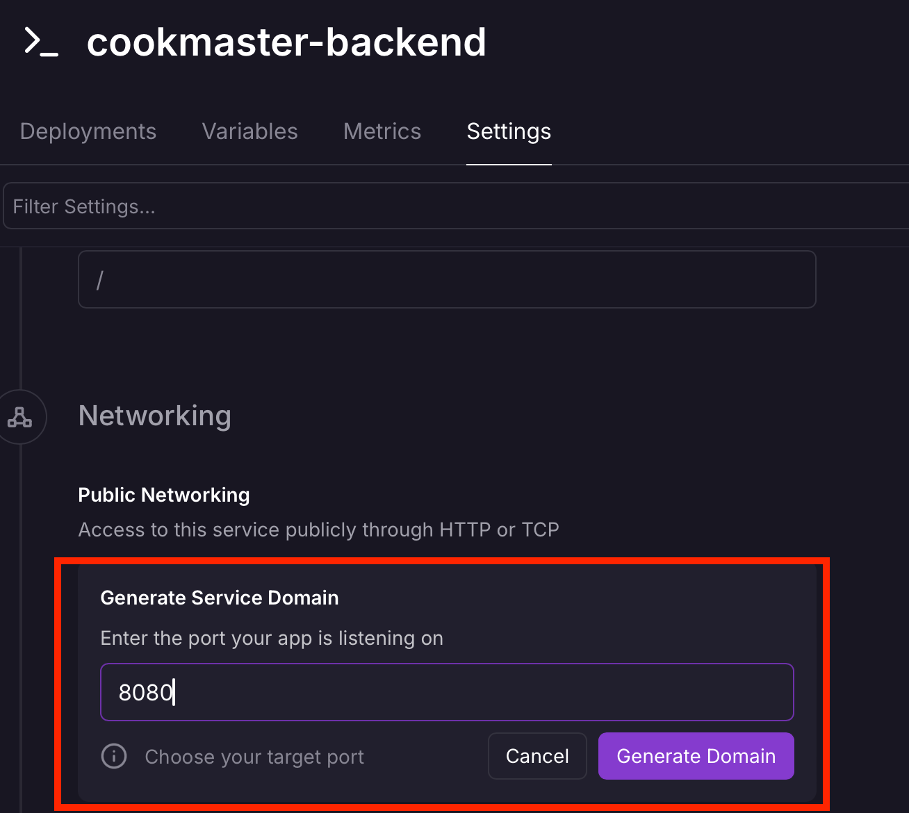

# 9.6 - Configurando Serviços no Railway

> Seção 9 - Automatização e Deploy de Aplicações · Lição 6 de 11

Agora que temos uma conta, vamos criar um novo projeto no Railway. Para isso, clique no botão **New Project**, conforme destacado na imagem abaixo:

Criação de um novo projeto no `Railway`

Ao clicar em New Project, será exibido um conjunto de opções que podem ser escolhidas a depender do contexto do *deploy*. Com a intenção de termos um ambiente flexível, iremos escolher a opção **Empty project**, conforme destacado na imagem abaixo:

Tipos de projeto disponíveis no `Railway`

Em seguida, um projeto vazio será criado e exibido na **dashboard** do Railway. Por padrão, todo projeto criado no Railway recebe um nome aleatório e contém um ambiente chamado `production`.

Você pode alterar o nome do projeto nas configurações (botão **Settings** no canto superior direito) e criar outros ambientes, como staging (ambiente de homologação similar ao de produção). Isso é útil para testar funcionalidades antes de disponibilizá-las no ambiente de produção.

## Adicionando um Banco de Dados MySQL

Vamos começar adicionando um banco de dados MySQL ao projeto. Clique no botão **Create**, localizado no canto superior direito:

Criação de um novo projeto no `Railway`

Será exibida uma janela que pergunta qual tipo de serviço será adicionado. Clique em **Database** e, em seguida, em **Add MySQL**.

Depois de realizar o procedimento acima, o serviço MySQL será configurado e estará em execução no projeto.

> **Atenção ⚠️:** Assim que o serviço MySQL for adicionado, o uso dos recursos (dólares e horas) do plano gratuito será iniciado. Caso os recursos do plano sejam esgotados, nenhum valor adicional será cobrado. Para evitar cobranças, você pode remover todos os serviços do projeto.

Na `dashboard`, clique no `card` do `MySQL` para abrir uma janela lateral com opções de configuração e gerenciamento.

Uma dessas opções é `Variables`, que exibe as variáveis de ambiente necessárias para conectar ao banco de dados:

Variáveis de ambiente do `MySQL`

A API **Cookmaster** já está preparada para usar essas variáveis de ambiente e acessar o banco de dados configurado no Railway.

## Adicionando o Serviço Back-End

Agora, vamos adicionar o serviço do back-end da API Cookmaster. Clique no botão **Create** no canto superior direito e escolha a opção **Empty Service**. Isso cria um serviço vazio, que pode ser customizado conforme necessário. O serviço quando criado, pode estar debaixo do `card` do `MySQL` ou o inverso, caso isso ocorra, basta arrastar o `card` para visualizar ambos.

Inicialmente, o serviço será criado com um nome aleatório. Para renomeá-lo, clique no `card` do serviço recém-criado. Na janela lateral que será aberta, clique no ícone de edição ao lado do nome atual. Insira um nome como `cookmaster-backend` e pressione `Enter` para salvar. Depois vá até **Settings** para visualizar as configurações da aplicação.

Configurações do serviço da API Cookmaster

As configurações do serviço estão divididas nas seguintes seções:

-   **Source**: Define de onde o código será obtido, como um repositório GitHub ou uma imagem Docker.
-   **Networking**: Configurações relacionadas à rede, como o domínio de acesso.
-   **Build**: Define como o serviço será construído, incluindo diretórios monitorados para disparar novos builds.
-   **Deploy**: Configura o comando de inicialização da aplicação.
-   **Config-as-code**: Permite subir um arquivo com as configurações das seções anteriores.
-   **Feature-flags**: Habilita ou desabilita funcionalidades específicas do Aplicativo.
-   **Danger**: Gerencia a exclusão do serviço.

Após configurar o serviço, ele estará adicionado ao projeto no Railway. O próximo passo será vincular o código do back-end, o que faremos em breve!

## Fazendo Deploy do Serviço Back-End

Com o serviço configurado, clique no botão **Deploy** no centro da página. Isso iniciará o processo de implantação da **API Cookmaster**.

Deploy do serviço `cookmaster-backend`

Criando uma URL para o Serviço `coomaster-backend`

Após o **deploy**, gere uma URL para o serviço. Clique no `card` do cookmaster-backend, vá até **Settings**, role até **Networking**, adicione a porta 8080 e clique em **Generate Domain**.

Com isso, o Railway fornecerá uma URL acessível para o back-end da API Cookmaster!

Gerando uma URL para o serviço `cookmaster-backend`

OBS da IA

**Para o SAP CAP**

-   Equivalente no BTP: em vez de criar o banco manualmente, o `mta.yaml` declara os serviços (HANA Cloud, XSUAA/IAS, destination) e o deploy cria e vincula tudo.

