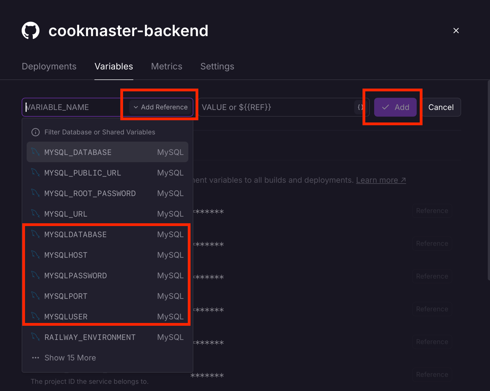
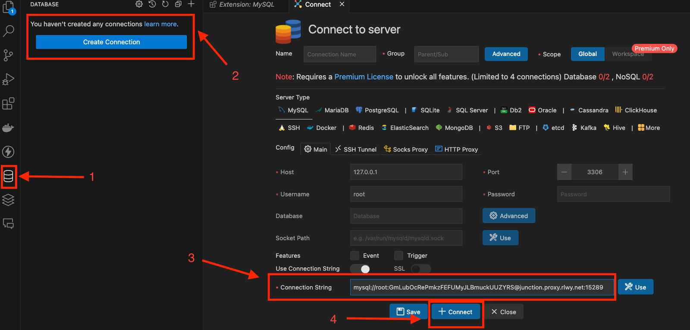
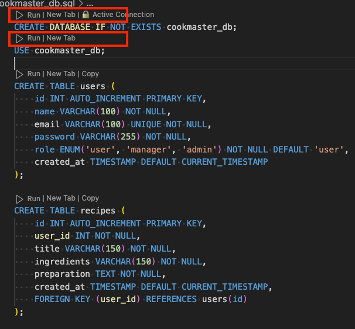
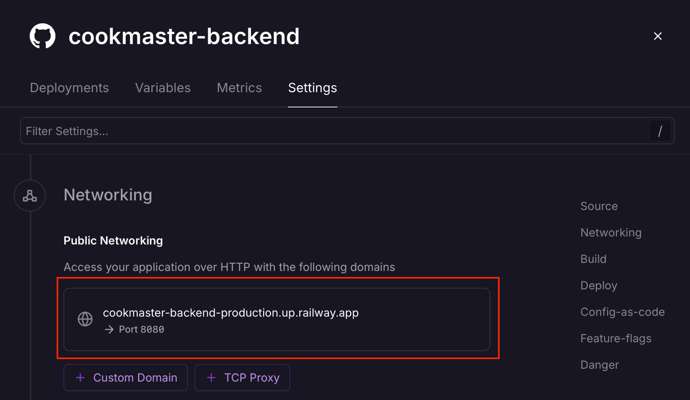

# 9.7 - Deploy da aplicação no Railway

> Seção 9 - Automatização e Deploy de Aplicações · Lição 7 de 11

Agora que realizamos todas as configurações necessárias, vamos fazer o deploy da nossa aplicação no Railway. Antes de começar, faremos alguns ajustes no projeto para garantir que tudo funcione corretamente.

## Configurando o arquivo `connection.js`

Para que a aplicação consiga se conectar ao banco de dados, é necessário ajustar as variáveis de ambiente no arquivo `connection.js`, localizado em `src/model/connection.js`, para refletir as configurações geradas no MySQL do Railway. Atualize o arquivo conforme o exemplo abaixo:

```javascript
const mysql = require('mysql2/promise');
const connection = mysql.createPool({
  host: process.env.MYSQLHOST,
  port: process.env.MYSQLPORT,
  user: process.env.MYSQLUSER,
  password: process.env.MYSQL_ROOT_PASSWORD,
  database: process.env.MYSQL_DATABASE,
});
module.exports = connection;
```

Com o arquivo configurado, prossiga para criar um repositório no seu GitHub pessoal. Faça o push do código da sua aplicação ou utilize o repositório fornecido nesse link [09-automatizacao-e-deploy-de-aplicacoes/parte-02-deploy](https://github.com/learnwithtrybe/node-codigos/tree/main/09-automatizacao-e-deploy-de-aplicacoes/parte-02-deploy). Este repositório será vinculado ao Railway para deploy.

## Vinculando o código com o serviço `cookmaster-backend`

Para vincular o código ao serviço criado no Railway, siga os passos abaixo:

1.  Acesse a **dashboard** do Railway e clique no `card` do serviço `cookmaster-backend`.
2.  Na aba **Settings**, configure o código da API como indicado:
3.  **Source**: Clique em **Connect Repo** e selecione o repositório `cookmaster-api` do seu GitHub. Autorize o acesso do seu GitHub, se necessário.
4.  **Build**: Clique em **Watch Paths** e adicione a string `/src/**`. Isso garante que o serviço reinicie automaticamente ao alterar arquivos dentro da pasta `/src`.
5.  **Deploy**: Clique em **Custom Start Command** e insira o comando `npm start` para definir como o serviço será iniciado.

### Adicionando variáveis de ambiente

1.  Acesse a aba Variables e clique em New Variable.
2.  Para cada variável necessária, clique em Add Reference, selecione a variável correspondente no serviço MySQL e clique em Add.
3.  Adicione as variáveis `MYSQLHOST`, `MYSQLPASSWORD`, `MYSQLPORT`, `MYSQLUSER` e `MYSQLDATABASE`.
4.  Atenção: Altere o valor de MYSQLDATABASE para `cookmaster_db`.



Passo a passo para criar variáveis de ambiente no serviço `cookmaster-backend`

Após configurar todas as variáveis, clique em **Deploy** no centro da página para iniciar o serviço.

<details>
<summary>OBS da IA</summary>

**Para o SAP CAP**

-   No BTP não se configuram usuário/senha do banco em variáveis: as credenciais chegam pelo service binding (`VCAP_SERVICES` no Cloud Foundry, secrets no Kyma) e o CAP as lê sozinho. Para testar localmente com serviços reais use `cds bind` + `cds watch --profile hybrid`.

</details>

## Populando o banco de dados

Com a aplicação configurada, agora vamos popular o banco de dados utilizando a extensão [Database Client](https://database-client.com/#/home) do `VSCode`.

1.  Obtenha a URL de conexão do banco de dados no card do serviço MySQL, acessando a variável de ambiente `MYSQL_PUBLIC_URL`.
2.  Use essa URL para se conectar ao banco de dados com o `Database Client`.



Conexão com o MySQL Railway

1.  Execute o script SQL localizado em `cookmaster_db.sql` para criar e popular as tabelas.



Execução das Queries MySQL

Com tudo configurado, a aplicação estará pronta para uso! Acesse a API pela URL exibida no card do serviço `cookmaster-backend`.



URL de acesso da Aplicação

Agora, que tal ver um apanhado geral do que aprendemos para consolidar de vez esse conhecimento? Para isso, é só assistir ao vídeo abaixo!

<details>
<summary>OBS da IA</summary>

**CI/CD**

-   Do jeito configurado aqui, o Railway faz deploy de **todo** push na branch, **mesmo com testes quebrados**. Ative **Wait for CI** no serviço para que ele espere o GitHub Actions passar, ou faça o deploy pelo próprio pipeline.
-   Popular o banco manualmente funciona uma vez. Para as próximas mudanças, use **migrations** versionadas aplicadas no deploy.
-   Veja [IA.5 - Deploy contínuo da API Cookmaster](../12%20-%20OBS%20da%20IA%20-%20CI-CD%20-%20o%20m%C3%ADnimo%20para%20deploy%20automatizado/05%20-%20Deploy%20cont%C3%ADnuo%20da%20API%20Cookmaster.md).

</details>
